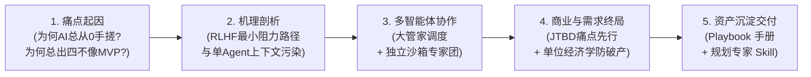

# 💼 商业软件开发大管家 (Project Development Planner)

> **“按部就班的研发流程只是执行手段。如果不把【用户需求先行】和【商业闭环】放在最前头，用最顶级的架构写出来的也只是无人买单的自嗨废品。”**

这是一个面向创始人、CTO、独立开发者（Indie Hacker）与技术团队打造的高阶“大管家”智能体 Skill。它不负责底层的盲目手写代码，而是化身为你的 **CEO、商业顾问、产品经理与架构师**，以 **“需求验真先行，商业闭环兜底，开源基座起步，安全合规并重，多智能体协同交付”** 为核心信条，通过严谨的 **7 阶段商业落地流水线**，帮你把一个模糊的“点子”一步步拆解为可盈利、可落地的敏捷工程工单。

---

## 💡 为什么需要它？思想演进与底层逻辑 (Background & Rationale)

为什么普通 AI 在辅助编程时总是天生喜欢“从零手搓玩具代码”？为什么总是一上来就写粗糙的单文件 MVP？

我们在深入复盘中彻底梳理了这一系列痛点的根本原因，并沉淀了完整的思想演进白皮书：  
📄 **[从技术自恋到商业闭环：AI 辅助研发与项目规划演进全纪实与实施总则 (docs/ai_development_evolution_and_rationale.md)](docs/ai_development_evolution_and_rationale.md)**



### 思想演进的四大核心台阶：

1. **从病灶出发（第 1~3 章）**：详细剖析了 AI 天生喜欢在单文件写玩具代码的底层奖励机制（RLHF 造成的即时交差心态与上下文偷懒），以及为什么成熟架构师思维必须基于社区最顶级的开源预制件（Tailwind、shadcn/ui、Prisma、Zod 等）。
2. **多智能体破局（第 4 章）**：推导了“三大专职独立专家军团（12 核心角色）”体系：由 1 个大管家作为 Orchestrator 统控**【商业战略与风控军团】**（CFO财务、CISO合规、PM规划）、**【产研与 AI 工程军团】**（开源架构师、AI工程架构师、UI/UX设计、全栈特工、DevOps运维SRE、QA对抗质检）与**【商运增长与数据军团】**（营销策划CMO、流量推广Growth、用户运营COO、数据归因BI），彻底封堵单点盲区与自我放水，实现从商业构想到持续造血的完整闭环。
3. **商业终局升华（第 5~6 章）**：讲透了“标准研发流程只是工具”，必须将 **JTBD（Jobs To Be Done）需求验真**、**假门把手测试（Smoke Test）** 与 **算力/出网防破产红线（Cloudflare R2 零出网、BullMQ 异步队列）** 放在写代码之前。
4. **可复用的标准化武器库（第 7 章）**：总结了实战手册与具备强约束力的通用规划 Skill，确保每一次项目规划都在商业与技术的双轨安全防线内运行。

---

## ✨ 核心特性

- **🔘 选择题驱动 (Choice-Driven)**：人类不擅长填空题，但擅长做选择。内置《设计风格字典》与《功能积木库》，直接提供 Plan A / Plan B 供你权衡抉择。
- **🤖 三大专家军团多智能体协同 (Multi-Agent Tri-Pods)**：作为 Orchestrator（统筹者），统控【战略风控】、【产研工程】与【商运增长】三大军团（12 专职角色），智能路由并生成“移交上下文”，打破上下文污染与角色放水，保障工业级商业成功。
- **🧭 动态项目策略**：自动识别**全新项目 (Greenfield)**、**二次开发/重构 (Brownfield)** 和 **传统项目 AI 化 (AI Transformation)**，提供如“绞杀者模式”、“Sidecar”等差异化架构方案。
- **💰 商业防破产机制**：在写代码前强制引入“单位经济学 ($LTV > 3 \times CAC$)”测算，建立零出网费对象存储、异步算力队列与防刷量限流护城河。

---

## 🗺️ 7 大标准落地阶段 (Stage Gates)

每个阶段均设置严格的卡点（Stage Gate），输出标准文档后**强制暂停**，必须等待用户确认后才推进下一阶段，严禁抢跑：

1. **阶段 0**：用户需求先行与价值主张验真（PMF / 痛点定级 / Smoke Test 假门把手）
2. **阶段 1**：商业模式、变现路径与单位经济学测算（LTV:CAC / 支付网关合规 / 防破产架构）
3. **阶段 2**：敏捷产品需求文档 (PRD) 与页面交互逻辑（User Story / Wireframe 结构）
4. **阶段 3**：开源脚手架选型与二次开发规划（黄金技术栈匹配 / 严禁从零手搓轮子）
5. **阶段 4**：系统契约、数据模型、合规与设计规范（ER 图 / API 契约 / GDPR 合规）
6. **阶段 5**：AI 智能体管线与 Prompt 架构设计（Agent 拓扑 / Ragas 评测 / 降级策略）
7. **阶段 6**：多智能体落地拆解与敏捷验证工单（EPIC -> Task / QA 对抗测试 / DevOps 部署）

---

## 📁 目录结构说明

```text
.
├── SKILL.md                 # 🧠 主控大脑：定义 Agent 的行为准则、交互模式与 7 大阶段卡点
├── docs/                    # 📚 深度演进纪实、实战工程手册与技术栈报告
│   ├── ai_development_evolution_and_rationale.md # 思想演进全纪实与实施总则（白皮书）
│   ├── ai_engineering_playbook.md                # 商业闭环与多智能体实战手册
│   └── tech_stack_architecture_report.md         # 六大多模态赛道黄金技术栈深度报告
├── assets/                  # 📄 资产库：标准化的阶段输出模板
│   ├── stage-0-template.md  # 需求验真报告模板
│   ├── stage-1-template.md  # 商业测算报告模板
│   └── prd-template.md      # 标准 PRD 与低保真原型模板
└── references/              # 📖 知识库：供 AI 随时查阅的专业字典
    ├── agent-skill-routing.md    # 多智能体协同路由表
    ├── design-styles.md          # UI 视觉风格与前端代码映射字典
    ├── economics-formulas.md     # 商业变现与单位经济学公式
    ├── feature-modules.md        # 常见 SaaS/AI 工具功能积木库
    ├── project-type-strategies.md# 不同类型项目的差异化分析策略
    └── tech-stack-matrix.md      # 黄金技术栈与平滑演进架构指南
```

---

## 📖 核心文档索引

| 文档名称 | 路径 | 说明 |
| :--- | :--- | :--- |
| **思想演进全纪实与实施总则** | [docs/ai_development_evolution_and_rationale.md](docs/ai_development_evolution_and_rationale.md) | 深度剖析 AI 研发痛点根源、多智能体破局、商业需求终局与资产沉淀全景 |
| **商业闭环与研发实战手册** | [docs/ai_engineering_playbook.md](docs/ai_engineering_playbook.md) | 涵盖 JTBD 验真自检、防破产算力架构、六大黄金栈与 Master Prompt |
| **多模态架构与技术选型报告** | [docs/tech_stack_architecture_report.md](docs/tech_stack_architecture_report.md) | 六大多模态赛道（写作/出图/写歌/播客/视频/伴侣）工业级选型矩阵 |

---

## 🚀 跨平台使用指南 (How to Use)

本大管家架构不仅原生支持 Trae / Antigravity，其标准化的 Markdown 资产结构也使其能轻松适配其他 AI 编程 IDE 和通用大模型平台。

### 🟢 方案一：在 Trae / Antigravity 中使用 (原生支持)

1. 在你的项目工作区根目录下，确保存在 `.trae/skills/`（或 `.agents/skills/`）文件夹。
2. 将本仓库直接克隆到该目录，并命名为 `project-development-planner`：
   ```bash
   mkdir -p .trae/skills
   cd .trae/skills
   git clone https://github.com/cunzailv/shangyeruanjiankaifa.git project-development-planner
   ```
3. 重启或刷新 IDE，在对话框中输入 `/project-development-planner 我想做一个XXX` 即可唤醒大管家。

### 🔵 方案二：在 Cursor / Windsurf 中使用

这两款 IDE 支持项目级别的指令规则配置：

1. 将本仓库克隆到你的项目根目录下的某个文件夹（例如 `docs/planner/`）。
2. 在项目的 `.cursorrules` 或 `.windsurfrules` 文件中添加以下指令：
   > `当你需要进行项目规划时，请严格遵循 docs/planner/SKILL.md 中的 7 大阶段规范与卡点。在规划过程中，请随时读取 docs/planner/assets、docs/planner/docs 和 docs/planner/references 目录下的模板与知识库。`
3. 在对话框中 `@docs/planner/SKILL.md`，并输入你的产品构想即可开始。

### 🟣 方案三：在 Claude Projects 中使用

Claude 的 Projects 功能自带强大的 Knowledge (知识库) 和 Custom Instructions (自定义指令)，非常适合部署本管家：

1. 在 Claude Web 端创建一个新的 Project。
2. 将本仓库内的所有 `.md` 文件（特别是 `SKILL.md`、`docs/` 和 `references/` 文件夹里的所有内容）上传到该 Project 的 Knowledge 中。
3. 在 Project 的 Custom Instructions 中填入：
   > `你现在的身份是 Project Development Planner。请严格按照 Knowledge 中的 SKILL.md 规范与我对话，并严格执行 7 大阶段卡点。在给我提供选项时，请务必参考 Knowledge 中的各种字典和模板。`

### ⚪ 方案四：在通用大模型 (ChatGPT / Claude Web 等) 中使用

如果你没有使用任何专门的 IDE，也可以直接通过长文本 Prompt 来驱动：

1. 将 `SKILL.md` 的内容完整复制。
2. 粘贴给 AI，并在末尾附上：
   > `请扮演上述的“商业软件开发大管家”角色。现在我们开始阶段 0，我想做一个【这里填入你的构想】。由于你无法直接读取本地文件，在后续阶段中，如果需要参考特定的资产模板或知识库字典，请告诉我，我会将文件内容粘贴给你。`
