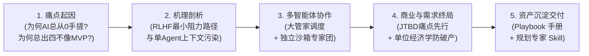
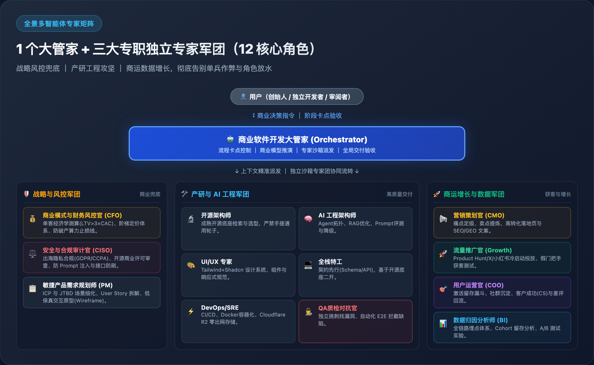

# 💼 商业软件开发大管家 (Project Development Planner)

[](LICENSE)
[](#-安装与快速开始)
[](https://www.npmjs.com/package/dsh-business-planner)
[](https://github.com/cunzailv/shangyeruanjiankaifa)

> **“按部就班的研发流程只是执行手段。如果不把【用户需求先行】和【商业闭环】放在最前头，用最顶级的架构写出来的也只是无人买单的自嗨废品。”**

这是一个面向创始人、CTO、独立开发者（Indie Hacker）与技术团队打造的高阶“大管家”智能体 Skill。它不负责底层的盲目手写代码，而是化身为你的 **CEO、CFO、CMO、产品总监与首席架构师**，以 **“需求验真先行，商业闭环兜底，开源基座起步，三大军团协同，安全合规并重”** 为核心信条，通过严谨的 **7 阶段商业落地流水线 (Stage Gates)**，帮你把一个模糊的“点子”一步步拆解为可盈利、可落地的敏捷工程工单。

它内置 **38 个已核验的 GitHub 开源案例**（真实 Star 数、真实许可证、真实归档状态），把“找个开源项目抄一下”这种危险动作，变成一张**能直接判断「借哪层、能不能拿去卖」的评估矩阵**。详见 [📦 开源案例库与二开边界清单](references/github-open-source-cases.md)。

> **🧩 已提供 DSH 插件**：装进 DeepSeek Harness 后，左侧栏会多一个「规划大管家」入口 —— 7 阶段进度、卡点产出、参考文档与启动指令一屏可查；对话框里输入 `/project-development-planner` 也能直接唤醒。装法见 [安装与快速开始](#-安装与快速开始)。

---

## 💡 为什么需要它？思想演进与底层逻辑 (Background & Rationale)

为什么普通 AI 在辅助编程时总是天生喜欢“从零手搓玩具代码”？为什么总是一上来就写粗糙的单文件 MVP？为什么很多独立产品做出来了却根本无人买单、上线即死？

我们在深入复盘中彻底梳理了这一系列痛点的根本原因，并沉淀了完整的思想演进白皮书：  
📄 **[从技术自恋到商业闭环：AI 辅助研发与项目规划演进全纪实与实施总则 (docs/ai_development_evolution_and_rationale.md)](docs/ai_development_evolution_and_rationale.md)**



### 思想演进的四大核心台阶：

1. **从病灶出发（第 1~3 章）**：详细剖析了 AI 天生喜欢在单文件写玩具代码的底层奖励机制（RLHF 造成的即时交差心态与上下文偷懒），以及为什么成熟架构师思维必须基于社区最顶级的开源预制件（Tailwind、shadcn/ui、Prisma、Zod 等）。
2. **多智能体破局（第 4 章）**：推导了“三大专职独立专家军团（12 核心角色）”体系：由 1 个大管家作为 Orchestrator 统控**【商业战略与风控军团】**、**【产研与 AI 工程军团】**与**【商运增长与数据军团】**，彻底封堵单点盲区与自我放水，实现从商业构想到持续造血的完整闭环。
3. **商业终局升华（第 5~6 章）**：讲透了“标准研发流程只是工具”，必须将 **JTBD（Jobs To Be Done）需求验真**、**假门把手测试（Smoke Test）** 与 **算力/出网防破产红线（Cloudflare R2 零出网、BullMQ 异步队列）** 放在写代码之前。
4. **可复用的标准化武器库（第 7 章）**：总结了实战手册与具备强约束力的通用规划 Skill，确保每一次项目规划都在商业与技术的双轨安全防线内运行。

---

## 🏛️ 全景多智能体专家军团矩阵 (The 12-Role Multi-Agent Army)

很多项目破产，不是死在代码有 Bug，而是死在**缺乏合规审查被监管重罚、缺乏 AI 架构导致 Token 账单爆炸、缺乏运维导致流量一冲服务器宕机、缺乏营销推广导致无人问津**。

大管家旗下统控 **三大专职独立专家军团（共 12 大核心角色）**，每个角色拥有独立沙箱上下文，各司其职，坚决杜绝“既当运动员又当裁判”的角色放水：



| 军团类别 | 专职角色 | 职责使命 | 封堵的致命死穴 |
| :--- | :--- | :--- | :--- |
| **🛡️ 商业战略与风控** | **💰 财务风控官 (CFO)** | 测算单客经济学 ($LTV > 3 \times CAC$)，设计阶梯定价与算力止损线 | 防止算力入不敷出、上线即破产 |
| | **⚖️ 安全合规官 (CISO)** | 审查 GDPR/CCPA 出海隐私、开源商用许可冲突、配置防 Prompt 注入与接口防刷 | 防止刚上线就被欧洲监管罚款或 Stripe 封停 |
| | **📋 产品规划师 (PM)** | 细化 ICP 画像、梳理核心 JTBD 场景与低保真原型 (Wireframe) | 防止需求假大空、核心业务交互逻辑断层 |
| **🛠️ 产研与 AI 工程** | **🔬 开源系统架构师** | 在 GitHub 检索成熟可商用底座，核验许可证（AGPL/自定义许可/归档），界定二开边界与 ADR 架构决策 | 杜绝从零手搓通用轮子，也杜绝把高星 AGPL 项目当基座卖钱 |
| | **🧠 AI 工程架构师** | 设计 Agent 协作拓扑、RAG 向量检索优化、通过 Ragas 评测防幻觉 | 防止 API 调用胡言乱语、Token 账单爆表 |
| | **🎨 UI/UX 规范专家** | 基于 Tailwind + Shadcn 输出设计 Token、组件体系与响应式规约 | 告别粗糙山寨的前端 Demo 界面 |
| | **💻 全栈特工** | 契约先行 (Schema/API)，在开源基座上实现核心差异化业务 | 拒绝过度工程，产出高质可维护的代码 |
| | **⚡ DevOps/SRE 专家** | 构建 CI/CD、Docker 镜像，配置 Cloudflare R2 零出网存储与全球 CDN | 防止 Product Hunt 流量一冲服务器瞬间宕机 |
| | **🕵️ QA 质检对抗官** | 独立沙箱对抗挑刺、执行端到端自动化测试，缺陷不归零绝不放行 | 彻底终结“自己写代码自己测”的放水自欺欺人 |
| **🚀 商运增长与数据** | **📢 营销策划官 (CMO)** | **① 营销管全局**（ICP/定位/定价/增长模型/预算配比/目标数字）+ **② 策划出主意**（Big Idea / Creative Brief / 内容日历 / 素材脚本 / 视觉锤） | 防止"营销就是投广告"、"策划就是写文案"式的混为一谈 |
| | **🚀 流量推广官 (Growth)** | **③ 推广造声量**（19 渠道斗牛犬筛选、1 主 2 测、社区/目录站/SEO、声量四信号）+ **④ 投放买曝光**（三条线、账户结构、24 条素材矩阵、止损规则、归因） | 解决渠道错配，也解决"一停投新增就归零"的假增长 |
| | **🎯 用户运营官 (COO)** | 承接推广与投放带来的人：定义激活动作、搭私域/客服链路、把差评与流失原因反哺回阶段 0，维护 D1/D7/D30 看板 | 防止用户一波流流失，也防止"注册量"这种虚荣指标冒充增长 |
| | **📊 数据归因分析师 (BI)**| 全局度量：埋点事件字典、UTM 三层归因 + 服务端回传、声量与投放双口径周报、A/B 或 geo holdout 增量验证 | 告别 last-click 自嗨，看清每一分推广与投放预算的真实增量 |

---

## ✨ 核心特性

- **🧭 左侧栏工作台 (DSH Panel)**：插件在 DSH 左侧栏注册「规划大管家」入口，7 阶段进度、每阶段卡点产出与参考文档、一键复制启动指令；进度存在本机 localStorage，不污染仓库。
- **🔘 选择题驱动 (Choice-Driven)**：人类不擅长填空题，但擅长做选择。内置《设计风格字典》与《功能积木库》，直接提供 Plan A / Plan B 供你权衡抉择。
- **🤖 三大专家军团多智能体协同 (Multi-Agent Tri-Pods)**：作为 Orchestrator（统筹者），统控【战略风控】、【产研工程】与【商运增长】三大军团（12 专职角色），智能路由并生成“移交上下文”，打破上下文污染与角色放水，保障工业级商业成功。
- **🧭 动态项目策略**：自动识别**全新项目 (Greenfield)**、**二次开发/重构 (Brownfield)** 和 **传统项目 AI 化 (AI Transformation)**，提供如“绞杀者模式”、“Sidecar”等差异化架构方案。
- **💰 商业防破产机制**：在写代码前强制引入“单位经济学 ($LTV > 3 \times CAC$)”测算，建立零出网费对象存储、异步算力队列与防刷量限流护城河。
- **📦 真实开源案例对标 (Verified Case Library)**：38 个高频使用的 GitHub 仓库逐一核验 **Star / 许可证 / 归档状态**，按「项目类型 → 受众场景 → 产品形态」三张表锁定“借哪一层、自己写哪一层”，并对 **AGPL/GPL 传染、自定义商用限制、已归档仓库** 设三票否决（例如 16.5 万星的 `stable-diffusion-webui` 是 AGPL-3.0、14.5 万星的 `ComfyUI` 是 GPL-3.0，直接并入闭源产品即是事故）。
- **📣 四层增长体系：营销 / 策划 / 推广 / 投放 (Four-Layer Growth)**：把混成一团的"营销"拆成四个有边界、有 KPI 的层 —— **营销管全局**（定位/定价/增长模型/预算配比）→ **策划出主意**（Big Idea / Brief / 内容与素材脚本）→ **推广造声量**（19 渠道斗牛犬筛选、社区/目录站/SEO）→ **投放买曝光**（三条线、24 条素材矩阵、止损与归因）。每层配"失灵症状"与拒收标准，并附 11 个**可自建的增长基建开源案例**与 6 组打法案例。
- **💰 变现模式库与副业单位经济 (Monetization Models)**：把"我该做什么赚钱"拆成 **10 类可对照的变现模型**（订阅工具 / B 端 SaaS / API-SDK / 代码资产 / 知识社群 / 流量联盟 / 技术服务 / 电商跨境 / 本地服务 / 内容 IP），每类给出启动成本、客单、毛利、**回本条件**与获客主路径；附 24 条来自真实方案的**参数区间**、6 个 0 预算冷启动招式，以及一张**灰产与资质红线判定表**（论文代写、视频搬运、账号发卡、无牌照荐股等一律不做）。

---

## 🗺️ 7 大标准落地阶段 (Stage Gates)

每个阶段均设置严格的卡点（Stage Gate），输出标准文档后**强制暂停**，必须等待用户确认后才推进下一阶段，严禁抢跑：

1. **阶段 0**：用户需求先行与价值主张验真（变现模型匹配 / PMF 信号 / 痛点定级 / Smoke Test 假门把手）
2. **阶段 1**：商业模式、变现路径与单位经济学测算（LTV:CAC / Runway / 保本销量 / 支付网关合规 / GTM 预算与投放止损线 / 防破产架构）
3. **阶段 2**：敏捷产品需求文档 (PRD) 与页面交互逻辑（User Story / Wireframe 结构）
4. **阶段 3**：开源脚手架选型与二次开发规划（黄金技术栈匹配 / 真实案例对标 / 许可证合规裁决 / 严禁从零手搓轮子）
5. **阶段 4**：系统契约、数据模型、合规与设计规范（ER 图 / API 契约 / GDPR 合规）
6. **阶段 5**：AI 智能体管线与 Prompt 架构设计（Agent 拓扑 / Ragas 评测 / 降级策略）
7. **阶段 6**：落地拆解与敏捷验证工单（EPIC -> Task / QA 对抗测试 / DevOps 部署 / 营销物料与投放排期）

---

## 📦 开源案例库速览（节选，完整版见 [references/github-open-source-cases.md](references/github-open-source-cases.md)）

| 你要做的事 | 首选对标案例 | Star | 许可证 | 结论 |
| :--- | :--- | :--- | :--- | :--- |
| 搭 SaaS 订阅骨架 | [`nextjs/saas-starter`](https://github.com/nextjs/saas-starter) | 16.2k | MIT | ✅ 可直接作基座 |
| 抄工程化配置（i18n/鉴权/CI） | [`ixartz/Next-js-Boilerplate`](https://github.com/ixartz/Next-js-Boilerplate) | 13.1k | MIT | ✅ 可直接作基座 |
| AI 对话产品骨架 | [`vercel/chatbot`](https://github.com/vercel/chatbot) | 21.0k | Apache-2.0 | ✅ 商用友好 |
| 学 Monorepo / 绞杀者改造 | [`calcom/cal.diy`](https://github.com/calcom/cal.diy)（原 cal.com） | 49.7k | MIT | ✅ 可借结构 |
| 私有化 RAG 知识库 | [`infiniflow/ragflow`](https://github.com/infiniflow/ragflow) | 93.6k | Apache-2.0 | ✅ 可私有化部署 |
| 订阅计费 / 权益 / 发票 | [`polarsource/polar`](https://github.com/polarsource/polar) | 10.5k | Apache-2.0 | ✅ 可作计费中台 |
| 生图后端 | [`Comfy-Org/ComfyUI`](https://github.com/Comfy-Org/ComfyUI) | 145.2k | GPL-3.0 | ⚠️ 只能独立进程调用 |
| 签署/合同类业务 | [`documenso/documenso`](https://github.com/documenso/documenso) | 15.7k | AGPL-3.0 | ❌ 只能读，不可闭源二开 |
| 官方订阅模板 | [`vercel/nextjs-subscription-payments`](https://github.com/vercel/nextjs-subscription-payments) | 7.7k | MIT | ❌ 2025-01 已归档，不可作基座 |

> 数据抓取自 GitHub API，截至 **2026-11-05**；复用时请复核，Star 数不等于可商用。

<details>
<summary><b>📊 点开查看完整榜单：38 个仓库按 8 类形态分组（含最后提交时间与判决）</b></summary>

**① SaaS 基座 / 脚手架**
| 仓库 | ★ | 许可 | 最后提交 | 判决 |
| :--- | :--- | :--- | :--- | :--- |
| [nextjs/saas-starter](https://github.com/nextjs/saas-starter) | 16.2k | MIT | 2025-12 | ✅ 首推基座（薄，需自建业务） |
| [ixartz/Next-js-Boilerplate](https://github.com/ixartz/Next-js-Boilerplate) | 13.1k | MIT | 2026-11 | ✅ 抄工程化配置 |
| [t3-oss/create-t3-app](https://github.com/t3-oss/create-t3-app) | 29.2k | MIT | 2025-12 | ✅ 类型安全脚手架（已趋稳定） |
| [vercel/nextjs-subscription-payments](https://github.com/vercel/nextjs-subscription-payments) | 7.7k | MIT | 2025-01 | ❌ 已归档 |
| [medusajs/medusa](https://github.com/medusajs/medusa) | 37.1k | MIT + EE 目录 | 2026-11 | ✅ 电商后端（EE 部分另许） |

**② 二开 / 重构参考**
| 仓库 | ★ | 许可 | 最后提交 | 判决 |
| :--- | :--- | :--- | :--- | :--- |
| [calcom/cal.diy](https://github.com/calcom/cal.diy) | 49.7k | MIT | 2026-11 | ✅ 抄 Monorepo 拆分，别整仓 fork |
| [twentyhq/twenty](https://github.com/twentyhq/twenty) | 60.5k | AGPLv3 + 商业例外 | 2026-11 | ⚠️ 只读结构，不可闭源二开 |
| [documenso/documenso](https://github.com/documenso/documenso) | 15.7k | AGPL-3.0 | 2026-11 | ❌ 仅作合规读本 |
| [nocodb/nocodb](https://github.com/nocodb/nocodb) | 65.4k | 自定义（AGPL 系） | 2026-11 | ⚠️ 私有化可用，商用需核对 |

**③ AI 对话 / 写作**
| 仓库 | ★ | 许可 | 最后提交 | 判决 |
| :--- | :--- | :--- | :--- | :--- |
| [vercel/chatbot](https://github.com/vercel/chatbot) | 21.0k | Apache-2.0 | 2026-11 | ✅ 对话产品骨架 |
| [steven-tey/novel](https://github.com/steven-tey/novel) | 16.5k | Apache-2.0 | 2025-01 | ⚠️ 停更，仅作结构参考 |
| [langgenius/dify](https://github.com/langgenius/dify) | 160.5k | 修改版 Apache-2.0 | 2026-11 | ⚠️ 平台形态参考，多租户需核对 |

**④ AI 绘图 / 画布**
| 仓库 | ★ | 许可 | 最后提交 | 判决 |
| :--- | :--- | :--- | :--- | :--- |
| [Comfy-Org/ComfyUI](https://github.com/Comfy-Org/ComfyUI) | 145.2k | GPL-3.0 | 2026-11 | ⚠️ 只能独立进程调用 |
| [AUTOMATIC1111/stable-diffusion-webui](https://github.com/AUTOMATIC1111/stable-diffusion-webui) | 165.3k | AGPL-3.0 | 2026-03 | ❌ 只能读 |
| [excalidraw/excalidraw](https://github.com/excalidraw/excalidraw) | 135.2k | MIT | 2026-11 | ✅ 画布层可商用 |
| [tldraw/tldraw](https://github.com/tldraw/tldraw) | 51.3k | 自定义（水印/商用授权） | 2026-11 | ⚠️ 商用前核对条款 |

**⑤ AI 音频 / 视频**
| 仓库 | ★ | 许可 | 最后提交 | 判决 |
| :--- | :--- | :--- | :--- | :--- |
| [openai/whisper](https://github.com/openai/whisper) | 112.0k | MIT | 2026-08 | ✅ 转写管线可直接用 |
| [remotion-dev/remotion](https://github.com/remotion-dev/remotion) | 70.9k | 自定义（按实体规模） | 2026-11 | ⚠️ 公司规模超阈值需付费 |

**⑥ 实时语音 / Agent 编排**
| 仓库 | ★ | 许可 | 最后提交 | 判决 |
| :--- | :--- | :--- | :--- | :--- |
| [livekit/livekit](https://github.com/livekit/livekit) | 22.1k | Apache-2.0 | 2026-11 | ✅ WebRTC 基座 |
| [livekit/agents](https://github.com/livekit/agents) | 15.1k | Apache-2.0 | 2026-11 | ✅ 核心+插件范式 |
| [pipecat-ai/pipecat](https://github.com/pipecat-ai/pipecat) | 17.1k | BSD-2-Clause | 2026-11 | ✅ 语音管线，商用友好 |
| [crewAIInc/crewAI](https://github.com/crewAIInc/crewAI) | 60.5k | MIT | 2026-11 | ✅ 角色分工骨架 |
| [n8n-io/n8n](https://github.com/n8n-io/n8n) | 209.6k | fair-code 自定义 | 2026-11 | ⚠️ 对外售卖服务需授权 |
| [FlowiseAI/Flowise](https://github.com/FlowiseAI/Flowise) | 55.6k | 自定义 | 2026-08 | ❌ 已归档 |

**⑦ 企业 RAG / 知识库**
| 仓库 | ★ | 许可 | 最后提交 | 判决 |
| :--- | :--- | :--- | :--- | :--- |
| [infiniflow/ragflow](https://github.com/infiniflow/ragflow) | 93.6k | Apache-2.0 | 2026-11 | ✅ 私有化底座 |
| [langchain-ai/langchain](https://github.com/langchain-ai/langchain) | 149.1k | MIT | 2026-11 | ✅ 只作积木 |
| [qdrant/qdrant](https://github.com/qdrant/qdrant) | 35.4k | Apache-2.0 | 2026-11 | ✅ 向量库 |

**⑧ 平台侧基建（计费 / 观测 / 部署 / BaaS）**
| 仓库 | ★ | 许可 | 最后提交 | 判决 |
| :--- | :--- | :--- | :--- | :--- |
| [polarsource/polar](https://github.com/polarsource/polar) | 10.5k | Apache-2.0 | 2026-11 | ✅ 计费中台 |
| [PostHog/posthog](https://github.com/PostHog/posthog) | 40.7k | MIT 核心 + EE | 2026-11 | ⚠️ EE 目录另许 |
| [langfuse/langfuse](https://github.com/langfuse/langfuse) | 37.1k | MIT 核心 + EE | 2026-11 | ⚠️ EE 目录另许 |
| [vibrantlabsai/ragas](https://github.com/vibrantlabsai/ragas) | 16.2k | Apache-2.0 | 2026-02 | ✅ 评测基线 |
| [triggerdotdev/trigger.dev](https://github.com/triggerdotdev/trigger.dev) | 16.7k | Apache-2.0 | 2026-11 | ✅ 长任务异步 |
| [inngest/inngest](https://github.com/inngest/inngest) | 6.0k | SSPL（非 OSI） | 2026-11 | ❌ 自托管有约束 |
| [coollabsio/coolify](https://github.com/coollabsio/coolify) | 65.7k | Apache-2.0 | 2026-11 | ✅ 自托管交付 |
| [Dokploy/dokploy](https://github.com/Dokploy/dokploy) | 38.2k | 含 proprietary 目录 | 2026-11 | ⚠️ 商用需核对 |
| [supabase/supabase](https://github.com/supabase/supabase) | 114.6k | Apache-2.0 | 2026-11 | ✅ RLS 多租户 |
| [appwrite/appwrite](https://github.com/appwrite/appwrite) | 57.9k | BSD-3-Clause | 2026-11 | ✅ 自托管 + 商用 |
| [toeverything/AFFiNE](https://github.com/toeverything/AFFiNE) | 74.2k | 部分目录另许 | 2026-11 | ⚠️ CRDT 读本 |

</details>

> 每个仓库的**真实顶层目录结构**与"该抄哪层 / 别抄哪层"的判断，见案例库第 6 节《目录结构速读》。

---

## 📣 四层增长体系：营销 / 策划 / 推广 / 投放

很多人把"营销"一个词包住全部，于是四件事互相甩锅。本仓库把它切成四层，各有边界、各有 KPI、各有拒收标准（完整方法论见 [references/growth-marketing-playbook.md](references/growth-marketing-playbook.md)）：

| 层 | 一句话职责 | 核心产出 | 主 KPI | 出现即打回 |
| :--- | :--- | :--- | :--- | :--- |
| **① 营销** | **管全局**：卖给谁、卖什么、多少钱、走哪条路、怎么衡量 | 定位四件套 + 定价三档 + 增长模型 + 预算配比 + 目标数字 | LTV:CAC / 增速 / 渠道结构健康度 | ICP 写成"所有人"；无 CAC 上限；预算按心情分 |
| **② 策划** | **出主意**：这一波说什么、怎么说、靠什么被记住 | Big Idea + Creative Brief + 内容日历 + 素材脚本 + 视觉锤 | 3 秒记忆率 / 素材胜出率 / 互动率 | 一条素材讲 4 个卖点；换个产品名也能直接用 |
| **③ 推广** | **造声量**：用不花钱的方式让人知道、讨论、主动搜 | 1 主渠道 + 2 测试渠道、独立 UTM 与落地页、冷启动 SOP、发布排期 | 品牌词搜索量 / 自然注册 / 外部提及 / 分享率 | 罗列 5 个渠道却算不出单客成本；只发帖不养号 |
| **④ 投放** | **买曝光**：花多少钱、买多少、买回来的人划不划算 | 三条线（CAC 上限/ROAS/预算）+ 账户结构 + 24 条素材矩阵 + 止损规则 + 归因 | CPM / CTR / CPA / ROAS | 无止损线就开账户；一次改三个变量；只报 last-click |

```text
① 营销定盘 → ② 策划出弹 → ③ 推广放大（免费声量） → ④ 投放买量（付费曝光） → BI 回流 → ① 重新分配预算
```

**资源配比（经验起点）**：0→1 阶段推广占精力 60%、投放 ≤10% 预算；1→10 阶段投放 50%；10→100 阶段投放 60%。**顺序倒过来（先投放）= 用最贵的钱验证最不确定的假设。**

**增长三问（过卡点必答）**：① 目标 CPA 是多少、怎么算出来的？② 主渠道为什么是它、放量 3 倍会不会崩？③ 这笔钱的效果用什么口径证明？—— 三问答不全，不允许开始投放。

---

## 📁 目录结构说明

```text
.
├── LICENSE                  # ⚖️ 开源协议：MIT License
├── SKILL.md                 # 🧠 主控大脑：定义 Agent 的行为准则、交互模式与 7 大阶段卡点
├── package.json             # 🧩 DSH 插件清单（dsh.bundle.patch 指向挂载声明）
├── index.js                 # 🧩 DSH 宿主入口：把 SKILL.md 注册成 DSH 技能
├── client.js                # 🧩 DSH 客户端入口：左侧栏「规划大管家」入口 + 7 阶段面板
├── cordis.patch.yml         # 🧩 DSH bundle patch：安装后自动挂载插件行
├── icon.svg                 # 🧩 插件图标（DSH Plugins 页展示）
├── test/smoke.mjs           # 🧪 插件冒烟测试（node test/smoke.mjs）
├── docs/                    # 📚 深度演进纪实、实战工程手册与架构报告
│   ├── ai_development_evolution_and_rationale.md # 思想演进全纪实与实施总则（白皮书）
│   ├── ai_engineering_playbook.md                # 商业闭环与多智能体实战手册
│   ├── tech_stack_architecture_report.md         # 六大多模态赛道黄金技术栈深度报告
│   └── images/                                   # 2x Retina 高清项目架构与流程图
│       ├── 01_four_step_evolution.png            # 思想演进四大核心台阶
│       ├── 02_vanity_vs_commercial_loop.png      # 技术自嗨陷阱 vs 商业闭环对比
│       ├── 03_multi_agent_orchestration.png      # 三大专家军团 12 核心角色矩阵
│       ├── 04_stage_gates_funnel.png             # 7 大阶段卡点漏斗机制
│       └── 05_multimodal_golden_stacks.png       # 六大多模态黄金技术栈矩阵
├── assets/                  # 📄 资产库：标准化的阶段输出模板
│   ├── stage-0-template.md  # 需求验真报告模板
│   ├── stage-1-template.md  # 商业测算报告模板
│   └── prd-template.md      # 标准 PRD 与低保真原型模板
├── projects/                # 🧪 实战示例：拿真实产品把体系完整跑一遍
│   └── job-match-tool/
│       └── growth-plan.md   # 四层增长总案（LTV/CAC 推算 + 三条渠道 CPA 推演 + 90 天排期）
├── references/              # 📖 知识库：供 AI 随时查阅的专业字典
│   ├── agent-skill-routing.md    # 12 角色多智能体协同路由表
│   ├── design-styles.md          # UI 视觉风格与前端代码映射字典
│   ├── economics-formulas.md     # 商业变现与单位经济学公式
│   ├── feature-modules.md        # 常见 SaaS/AI 工具功能积木库
│   ├── github-open-source-cases.md # 38 个已验证开源案例 + 许可证红线 + 二开边界
│   ├── growth-marketing-playbook.md # 四层增长体系：营销管全局 / 策划出主意 / 推广造声量 / 投放买曝光
│   ├── monetization-models.md    # 十类变现模型 + 参数库 + 冷启动招式 + 灰产红线
│   ├── project-type-strategies.md# 不同类型项目的差异化分析策略
│   └── tech-stack-matrix.md      # 黄金技术栈与平滑演进架构指南
└── scripts/                 # ⚙️ 自动化构建脚本
    └── generate_article_diagrams.py # Playwright 高清架构配图自动化渲染脚本
```

---

## 📖 核心文档索引

| 文档名称 | 路径 | 说明 |
| :--- | :--- | :--- |
| **思想演进全纪实与实施总则** | [docs/ai_development_evolution_and_rationale.md](docs/ai_development_evolution_and_rationale.md) | 深度剖析 AI 研发痛点根源、多智能体破局、商业需求终局与资产沉淀全景 |
| **商业闭环与研发实战手册** | [docs/ai_engineering_playbook.md](docs/ai_engineering_playbook.md) | 涵盖 JTBD 验真自检、防破产算力架构、六大黄金栈与 Master Prompt |
| **多模态架构与技术选型报告** | [docs/tech_stack_architecture_report.md](docs/tech_stack_architecture_report.md) | 六大多模态赛道（写作/出图/写歌/播客/视频/伴侣）工业级选型矩阵 |
| **开源案例库与二开边界清单** | [references/github-open-source-cases.md](references/github-open-source-cases.md) | 38 个仓库的 Star/许可证/活跃度核验，按项目类型、受众场景、产品形态三表选型，附三票否决清单与评估矩阵模板 |
| **四层增长体系手册** | [references/growth-marketing-playbook.md](references/growth-marketing-playbook.md) | 营销管全局 / 策划出主意 / 推广造声量 / 投放买曝光：定位四件套、Big Idea 四检验、15 秒素材脚本、19 渠道斗牛犬、24 条素材矩阵、CPA·ROAS 止损、按层指标字典、6 组案例 + 11 个开源基建 |
| **四层增长总案实战示例** | [projects/job-match-tool/growth-plan.md](projects/job-match-tool/growth-plan.md) | 用 JD-简历匹配工具跑完四层：LTV ¥79 → CAC 上限 ¥26 → 三条渠道 CPA 推演（¥114~298，全部 4~11 倍超标）→ 结论"不获客投放"，附 12 条选题、2 条脚本、90 天排期与决策线 |
| **变现模式库与副业单位经济** | [references/monetization-models.md](references/monetization-models.md) | 10 类变现模型的可比参数（启动成本/客单/毛利/回本条件）、24 条样本区间、6 个 0 预算冷启动招式、PMF 信号与虚荣指标鉴别、灰产与资质红线判定表 |

---

## 🚀 安装与快速开始

本仓库既是 Skill，也是一个标准 **DSH 插件包**（`dsh-business-planner`），包含宿主与浏览器两半：

- **宿主**：把 `project-development-planner` 注册进技能目录，`references/` 与 `assets/` 由 `resourceBase` 指向包根目录，模型按阶段按需读取，**不需要往工作区复制任何文件**。
- **客户端**：在左侧栏注册「规划大管家」入口，点开是 7 阶段工作台（进度勾选、卡点产出、自查三问、参考文档、复制启动指令），进度存在本机 localStorage。

### 方式一：DSH 桌面版（推荐）

打开 **Plugins** 页 → 安装本地插件 → 选择本仓库目录；或直接粘贴包名 `dsh-business-planner` 从 npm 安装。装完**新开一个会话**即可使用。

### 方式二：DSH CLI

```bash
# 从 npm 安装（推荐）
dsh plugin --profile web add dsh-business-planner

# 从 GitHub 安装（跟踪 main 分支）
dsh plugin --profile web add github:cunzailv/shangyeruanjiankaifa

# 本地开发：link 到仓库目录，改 SKILL.md / 代码后重新加载即可生效
dsh plugin --profile web add link:/绝对路径/到本仓库
```

> 已发布到 npm：[`dsh-business-planner@0.1.0`](https://www.npmjs.com/package/dsh-business-planner)。npm 上另有一个 `dsh-project-planner` 与本项目无关，注意别装错。

### 唤醒大管家

```text
/project-development-planner 我想做一个……
```

装完后在 `/` 列表里能看到 `project-development-planner`；模型的描述匹配也会自动挂载它。

### 使用小贴士

- 本地 `link:` 安装指向仓库目录，移动或删除目录后插件会失效。
- 改 `SKILL.md` 后需重启 DSH 或重新加载插件（正文在插件加载时读取）。
- 只想验证插件包本身：`npm test`（不启动 DSH）。
- 其它 IDE / 通用大模型用法见文末 [跨平台使用指南](#-跨平台使用指南-how-to-use)。

---

## 🚀 跨平台使用指南 (How to Use)

本大管家架构不仅原生支持 Trae / Antigravity，其标准化的 Markdown 资产结构也使其能轻松适配其他 AI 编程 IDE 和通用大模型平台。

### 🟢 方案一：在 Trae / Antigravity 中使用 (原生支持)

1. 在你的项目工作区根目录下，确保存在 `.trae/skills/`（或 `.agents/skills/`）文件夹。
2. 将本仓库直接克隆到该目录，并命名为 `project-development-planner`：
   ```bash
   mkdir -p .trae/skills
   cd .trae/skills
   git clone https://github.com/cunzailv/shangyeruanjiankaifa.git project-development-planner
   ```
3. 重启或刷新 IDE，在对话框中输入 `/project-development-planner 我想做一个XXX` 即可唤醒大管家。

### 🔵 方案二：在 Cursor / Windsurf 中使用

这两款 IDE 支持项目级别的指令规则配置：

1. 将本仓库克隆到你的项目根目录下的某个文件夹（例如 `docs/planner/`）。
2. 在项目的 `.cursorrules` 或 `.windsurfrules` 文件中添加以下指令：
   > `当你需要进行项目规划时，请严格遵循 docs/planner/SKILL.md 中的 7 大阶段规范与卡点。在规划过程中，请随时读取 docs/planner/assets、docs/planner/docs 和 docs/planner/references 目录下的模板与知识库。`
3. 在对话框中 `@docs/planner/SKILL.md`，并输入你的产品构想即可开始。

### 🟣 方案三：在 Claude Projects 中使用

Claude 的 Projects 功能自带强大的 Knowledge (知识库) 和 Custom Instructions (自定义指令)，非常适合部署本管家：

1. 在 Claude Web 端创建一个新的 Project。
2. 将本仓库内的所有 `.md` 文件（特别是 `SKILL.md`、`docs/` 和 `references/` 文件夹里的所有内容）上传到该 Project 的 Knowledge 中。
3. 在 Project 的 Custom Instructions 中填入：
   > `你现在的身份是 Project Development Planner。请严格按照 Knowledge 中的 SKILL.md 规范与我对话，并严格执行 7 大阶段卡点。在给我提供选项时，请务必参考 Knowledge 中的各种字典和模板。`

### ⚪ 方案四：在通用大模型 (ChatGPT / Claude Web 等) 中使用

如果你没有使用任何专门的 IDE，也可以直接通过长文本 Prompt 来驱动：

1. 将 `SKILL.md` 的内容完整复制。
2. 粘贴给 AI，并在末尾附上：
   > `请扮演上述的“商业软件开发大管家”角色。现在我们开始阶段 0，我想做一个【这里填入你的构想】。由于你无法直接读取本地文件，在后续阶段中，如果需要参考特定的资产模板或知识库字典，请告诉我，我会将文件内容粘贴给你。`

---

## 📄 开源许可证 (License)

本项目采用 [MIT License](LICENSE) 开源协议。无论是商业应用、团队自用、开源二次开发还是打包集成，均可免费自由使用与修改，只需保留原作者版权声明即可。
