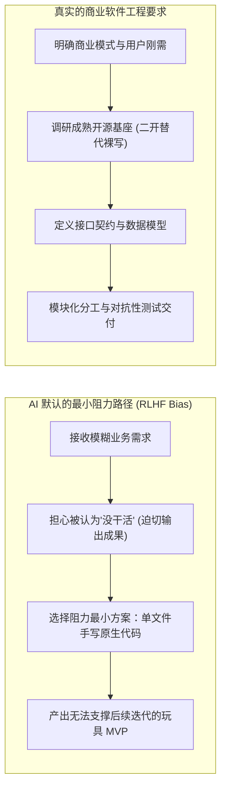
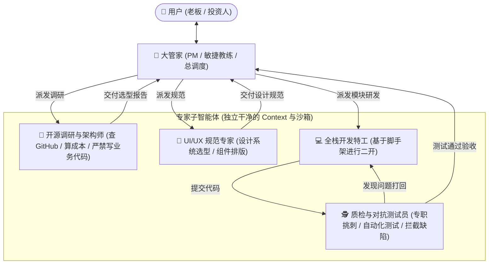

# 从技术自恋到商业闭环：AI 辅助研发与项目规划演进全纪实与实施总则

> **“按部就班的研发流程只是执行手段。如果不把【用户需求先行】和【商业闭环】放在最前头，用最顶级的架构写出来的也只是无人买单的自嗨废品。”**

---

## 目录
1. [起因与灵魂拷问：开发中的真实痛点](#一起因与灵魂拷问开发中的真实痛点)
2. [病灶剖析：为什么 AI 天生喜欢“从零手搓”与“抢跑 MVP”？](#二病灶剖析为什么-ai-天生喜欢从零手搓与抢跑-mvp)
3. [现象解码：为什么 Claude 给人的感觉像资深架构师？](#三现象解码为什么-claude-给人的感觉像资深架构师)
4. [认知的第一次跃迁：从“单兵作弊”到“分层多智能体团队”](#四认知的第一次跃迁从单兵作弊到分层多智能体团队)
5. [认知的终局跃迁：研发流程不是全部，用户需求先行与商业闭环才是根本](#五认知的终局跃迁研发流程不是全部用户需求先行与商业闭环才是根本)
6. [技术与成本底线：多模态 AIGC 黄金栈与防破产红线](#六技术与成本底线多模态-aigc-黄金栈与防破产红线)
7. [最终落地沉淀：我们构建的标准化资产全景](#七最终落地沉淀我们构建的标准化资产全景)

---

## 一、起因与灵魂拷问：开发中的真实痛点

本次复盘与方法论演进源自三个直击行业痛点的核心提问：

1. **为什么 AI 总是从 0 开始造轮子？**
   现实中建房子都是基于预制件、钢筋水泥和标准化组件。明明 GitHub 上有无数活跃度极高、协议允许商用的成熟开源系统，为什么 AI 总是喜欢自己从零手写几百行简陋代码？
2. **为什么 AI 上来就做 MVP，搞得“四不像”且不断浪费 Token？**
   正规软件生命周期（SDLC）极其严谨：**老板思想 $\rightarrow$ 产品规划 $\rightarrow$ UI 规范 $\rightarrow$ 技术架构 $\rightarrow$ 全栈开发 $\rightarrow$ 自动化测试 $\rightarrow$ 运维交付 $\rightarrow$ 用户反馈**。为什么 AI 会把所有流程全部压缩，直接产出一个玩具 Demo，导致后面无限改需求、无限打补丁？
3. **是提示词的问题吗？究竟怎样的模式才能真正帮到商业开发？**

---

## 二、病灶剖析：为什么 AI 天生喜欢“从零手搓”与“抢跑 MVP”？

这不是用户的指令问题，而是大模型底层机制与传统软件工程的**结构性矛盾**：

### 1. 训练奖励偏好（RLHF）的“即时交差心态”
模型被调优为“有求必应”。面对一个复杂需求，它害怕反问需求会被人类视为“偷懒”，因此本能地试图在单次回复中把所有角色一肩挑，输出一段能跑但毫无扩展性的单文件代码。

### 2. 读懂上万行开源项目的上下文代价
理解一个成熟的开源商业系统（如 Medusa、Refine、Chatwoot），需要巨大的 Context、文件检索以及目录感知。对 AI 来说，**从零手写几行原生代码的消耗极低，而二开一个大项目的消耗极大**。在没有严格指令约束时，AI 会本能选择偷懒。

### 3. 上下文污染与角色认知分裂
单 Agent 无法同时扮演“赶工期写代码的开发”与“找漏洞写用例的测试”。同一个大模型自己验证自己，必然自欺欺人。

---

## 三、现象解码：为什么 Claude 给人的感觉像资深架构师？

很多人观察到 Claude（特别是 3.5 / 3.7 Sonnet）在写项目时明显更成熟，主要源于 Anthropic 对其进行的差异化工程对齐：

1. **顾问型性格（Consultative Persona）**：Claude 面对大需求时，天生习惯先停下来梳理架构权衡（Trade-offs），列出可选方案和目录树，而不是直接无脑吐代码。
2. **现代开源生态预制件默认内化**：Claude 深度学习了现代 Web 黄金生态：写前端默认用 `Tailwind + shadcn/ui`，写全栈默认用 `Next.js + Prisma + Zod`。它把社区最好的预制件当成了默认积木。
3. **契约先行（Contract-First）**：先写 TypeScript `interface` 和数据库 Schema，再填充业务逻辑。

> **结论**：只要我们在提示词中剥夺普通 AI 的“盲目写代码权”，强制设置阶段卡点，任何顶尖大模型都能激发出这种资深架构师能力。

---

## 四、认知的第一次跃迁：从“单兵作弊”到“分层多智能体团队”

面对复杂系统，单一 Agent 的上下文必然枯竭。**唯一的解法是分工协作：大管家（调度）+ 专业子智能体团队。**

### 多智能体带来的降维优势：
* **上下文纯净度（100% 专注）**：每个子 AI 只看属于自己的上下文，彻底根除注意力稀释。
* **对抗性质量防线**：QA 角色专门用来挑刺、跑单元测试，不达标绝不交付给大管家，彻底终结残次品流向用户的尴尬局面。
* **用户角色升维**：用户不再是到处灭火的“改 Bug 工具人”，而是审阅关键里程碑的“技术投资人”。

---

## 五、认知的终局跃迁：研发流程不是全部，用户需求先行与商业闭环才是根本

> [!CRITICAL]
> **软件工程界最痛的领悟：用极其优雅规范的代码、极其先进的微服务架构，按部就班地做出了一个“根本没有人愿意买单”的废品。**

在探讨了标准 SDLC 和多智能体之后，我们迎来了最核心的升华：**标准研发流程只是执行工具，商业闭环与用户需求才是决定生死的罗盘。**

### 1. 用户需求先行（User Demand First & JTBD）
* **严苛的痛点分级**：必须区分**“着火级刚需（Hair-on-fire）”**与**“维他命补充（Nice-to-have）”**。用户只有在头发着火时，才会不计较产品简陋主动掏钱。
* **JTBD（Jobs To Be Done）框架**：用户买的不是“AI 模型”，而是雇佣产品解决特定场景下的痛点。
* **低成本验真手段（代码未动，验真先行）**：
  * **假门把手测试（Smoke Test）**：先做落地页测试购买意愿与点击率；
  * **绿野仙踪测试（Wizard of Oz）**：人工后台响应，验证交付价值。

### 2. 完整的商业闭环与单位经济学（Unit Economics）
* **健康的商业模型**：$LTV > 3 \times CAC$；
* **变现与支付通道**：提前规划出海合规支付（Stripe、Lemon Squeezy 自动代扣全球税）或国内合规；
* **定价与计费设计**：席位订阅制与基于点数（Credits/Token）的按量计费设计。

---

## 六、技术与成本底线：多模态 AIGC 黄金栈与防破产红线

融合我们深入研读的 [`tech_stack_architecture_report.md`](./tech_stack_architecture_report.md)，提炼出工业级实战底线：

### 1. 算力与流量“防破产红线”
* **带宽破产陷阱（S3 Egress Trap）**：
  * 传统 AWS S3 出网每 TB 收费高达 $90 美元。图片、音视频产品一旦有真实流量，带宽账单会瞬间击穿全部利润。
  * **生死线对策**：对象存储强制选用 **Cloudflare R2（零出网费 Zero Egress Fee）**，搭配前端预签名直传（Presigned URL），媒体文件完全不走应用服务器带宽。
* **长耗时算力长连接堵塞**：
  * 音视频生成（30~60秒）严禁 HTTP 同步阻塞！
  * **生死线对策**：必须引入 **Redis + BullMQ / Celery 异步队列流水线**，前端通过 WebSocket/SSE 轮询进度条。

### 2. 六大多模态垂直赛道工业级“黄金技术栈”

| 赛道 | 核心瓶颈 | 推荐黄金栈（绝不手搓） |
| :--- | :--- | :--- |
| **AI 写作平台** | 长文本丢失、打字机光标冲突 | **Next.js + Tiptap(ProseMirror) + Vercel AI SDK + Claude 3.5** |
| **AI 出图画布** | 局部重绘涂抹 Mask、流量成本 | **Fabric.js/Konva + Fal.ai/ComfyUI API + BullMQ + Cloudflare R2** |
| **AI 音乐生成** | 动态波形拖拽、歌词毫秒对齐 | **WaveSurfer.js + Suno API + Whisper(词级时间戳) + FFmpeg.wasm** |
| **AI 播客对谈** | 双主播脚本、切片无缝无爆音 | **双角色博弈 Prompt + ElevenLabs/CosyVoice + FFmpeg 交叉淡入淡出** |
| **AI 视频编排** | 分镜脚本串联、长任务容错 | **Remotion(React做视频) + 可灵/Runway API + Temporal/BullMQ** |
| **实时伴侣 Bot** | 全双工极低延迟(<800ms)、长记忆 | **LiveKit(WebRTC) + Mem0 记忆图谱 + WebSocket + Pixi.js** |

---

## 七、最终落地沉淀：我们构建的标准化资产全景

为了让这次深度探讨不仅仅停留在文字层面，而是成为未来每一次商业项目启动的坚实武器，我们完成了两项核心标准化资产的交付与部署：

### 资产一：完整的实战工程手册（更新完毕）
* **文档路径**：[`docs/ai_engineering_playbook.md`](./ai_engineering_playbook.md)
* **核心内容**：包含上述所有认知体系、架构红线、多模态技术选型表，以及开箱即用的工业级 Master Prompt 模板。

### 资产二：全商业项目规划 Skill（双重环境部署完成）
* **主控规范**：[`SKILL.md`](../SKILL.md)
* **全局路径**：`~/.gemini/config/skills/project-development-planner/SKILL.md`
* **项目路径**：`.agents/skills/project-development-planner/SKILL.md` 或 `.trae/skills/project-development-planner/SKILL.md`

#### 该 Skill 固化的标准化五阶推演漏斗：
1. **阶段 0：用户需求先行与价值主张验真**（JTBD 场景、刚需定级、假门把手测试）；
2. **阶段 1：商业闭环与单位经济学防破产**（支付合规接入、算力/带宽成本核算、Cloudflare R2 零出网、队列异步化）；
3. **阶段 2：GitHub 开源选型与二次开发架构**（结合六大多模态黄金栈，严禁从 0 造轮子）；
4. **阶段 3：系统契约、数据模型与设计规范**（ER 图、Prisma Schema、API 契约、Tailwind+Shadcn）；
5. **阶段 4：多智能体落地拆解与对抗测试验收**（模块分工、QA 拦截缺陷、一键 Docker 部署）。

今后无论面对什么新想法，只要唤醒此 Skill，AI 就绝不可能再滑向“写代码自嗨”的泥潭，而是始终以**成熟的商业与技术双轮驱动**，扎实交付真正具备商业竞争力的产品。
