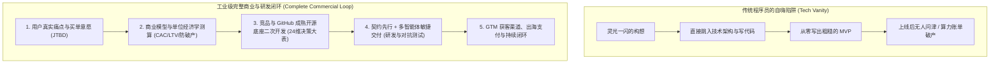
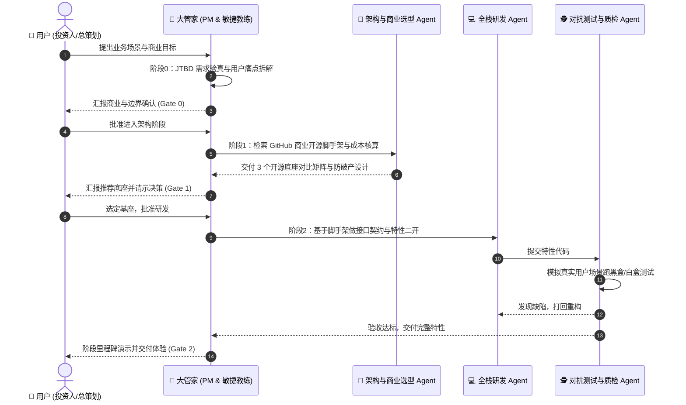

# 从商业验真到技术落地：AI 时代全商业闭环与多智能体研发实战手册
> “用户需求先行，商业闭环兜底，开源基座起步，多智能体协同交付”

---

## 目录
1. [认知核心：为什么“标准研发流程”只是冰山一角？](#一认知核心为什么标准研发流程只是冰山一角)
2. [第一重关卡：用户需求先行（User Demand First & JTBD）](#二第一重关卡用户需求先行user-demand-first--jtbd)
3. [第二重关卡：完整的商业闭环与防破产红线（Unit Economics）](#三第二重关卡完整的商业闭环与防破产红线unit-economics)
4. [第三重关卡：多模态 AIGC 黄金技术栈与开源选型（拒绝手搓）](#四第三重关卡多模态-aigc-黄金技术栈与开源选型拒绝手搓)
5. [第四重关卡：分层多智能体工程协同（大管家 + 专家团）](#五第四重关卡分层多智能体工程协同大管家--专家团)
6. [全流程实施落地指南与工业级 Master Prompt](#六全流程实施落地指南与工业级-master-prompt)

---

## 一、认知核心：为什么“标准研发流程”只是冰山一角？

软件工程界最大的悲剧是：**用极其优雅规范的代码、极其先进的微服务架构，按部就班地做出了一个“根本没有人愿意买单”的废品。**



### 为什么 AI 总是把项目带偏？
1. **技术自恋（Tech Vanity）**：AI 默认是技术实现导向的。它不会主动问你：“这个功能用户真的会掏钱吗？”、“你的获客成本（CAC）能不能被 LTV 覆盖？”
2. **缺乏商业常识约束**：AI 可以在代码里轻松写下“调用 S3 存储视频”、“调用 GPT-4 循环分析”，但它不知道**S3 每 TB 出网带宽高达 $90**，也不知道调用次数过多会导致商业模型直接崩溃。

---

## 二、第一重关卡：用户需求先行（User Demand First & JTBD）

在写下任何一行代码、甚至选定框架之前，必须执行严格的**需求真实性验真**。

### 1. 痛点级别判定：是“着火刚需”还是“维他命补充”？
* **着火级刚需（Hair-on-fire Problem）**：用户的头发着火了，哪怕你递过去一块砖头，他也会拿来拍灭火。用户愿意忍受极其简陋的界面、偶尔的报错，甚至主动求着付钱。
* **维他命级需求（Nice-to-have）**：听起来很酷，但用户“可买可不买”。如果一个 AI 项目属于这一类，研发周期越长，死得越彻底。

### 2. JTBD（Jobs To Be Done）框架自检清单
用户不会买你的“AI 算法”，用户雇佣你的产品去解决特定场景下的痛苦：
- **触发情境（Situation）**：用户在什么具体时刻、被什么痛点卡住了？
- **核心动机（Motivation）**：他迫切想摆脱什么痛苦？（省时间？避免被老板骂？多赚钱？）
- **预期结果（Outcome）**：使用你的产品后，衡量成功的指标是什么？（原来花 4 小时写文案，现在 5 分钟出稿）。

### 3. 最低成本的“烟雾验真法”（先不要写代码）
1. **虚假门把手测试（Fake Door / Smoke Test）**：先做一个 1 页的高转化率落地页（Landing Page），写明核心卖点与价格，挂上“立即订阅/加入等待名单”按钮。如果连 50 个愿意填邮箱/点支付的用户都没有，**立刻放弃或调整方向，严禁启动研发**。
2. **手动作业验证（Wizard of Oz）**：在前端放一个简单的表单，后端不接入任何昂贵的自动化架构，由人类创始人手动在后台调模型拼装结果发给用户，以此测试用户对交付成果的真实反馈。

---

## 三、第二重关卡：完整的商业闭环与防破产红线（Unit Economics）

商业软件的核心在于：**单客生命周期价值（LTV） > 3 倍单客获取成本（CAC） + 算力/流量服务成本（COGS）**。

### 1. 变现与支付通道（出海与国内准入）
* **海外 SaaS 首选**：**Stripe**（原生生态最全）或 **Lemon Squeezy / Paddle**（Merchant of Record 模式，自动代缴全球数字税，免去繁杂海外合规报税）。
* **国内商业**：微信支付、支付宝当面付/H5、虎皮椒/自建聚合支付；必须提前规划 ICP 备案与大模型算法合规。
* **商业定价模型**：
  * **席位订阅制（Seat Subscription）**：适合协同类工具；
  * **按量计费/点数包（Credits / Usage-based）**：AI 多模态产品标配，前端按点数扣除，后端对齐 Token 与 GPU 成本。

### 2. 算力与流量防破产红线（从 `tech_stack_architecture_report` 提炼）

> [!CAUTION]
> **多模态与 AI 项目最致命的“隐形破产陷阱”：出网带宽与算力长连接**

1. **带宽破产陷阱（S3 Egress Trap）**：
   * AWS S3 等传统云存储，每 TB 出网流量收费高达 **$90**。一旦生成的图片、音频、高清视频被大量访问，流量账单会瞬间击穿利润。
   * **生死线对策**：对象存储强制选用 **Cloudflare R2**（API 兼容 S3，但**零出网带宽费 Zero Egress Fee**），结合前端预签名直传（Presigned URL），媒体文件不经过后端服务器。
2. **算力长连接堵死网关**：
   * 音视频生成（30~60秒）严禁使用普通 HTTP 请求同步等待！
   * **生死线对策**：必须引入 **Redis + BullMQ / Celery 异步队列流水线**，前端提交后轮询或通过 WebSocket/SSE 监听进度条。

---

## 四、第三重关卡：多模态 AIGC 黄金技术栈与开源选型（拒绝手搓）

造房子必须用预制构件。针对当前六大主流垂直赛道，直接复用成熟的“工业级黄金技术栈”：

| 垂直赛道 | 核心痛点与瓶颈 | 推荐工业级开源/商业黄金栈 | 严禁踩坑点 |
| :--- | :--- | :--- | :--- |
| **1. AI 写作平台** | 长篇设定丢失、打字机光标冲突 | **Next.js + Tiptap(ProseMirror) + Vercel AI SDK + Claude 3.5** | 严禁手写 `contenteditable`；必须用 `diff-match-patch` 同步光标 |
| **2. AI 画布生图** | 局部重绘/涂抹 Mask、图片下行带宽 | **Fabric.js/Konva + Fal.ai/ComfyUI API + BullMQ + Cloudflare R2** | 严禁把图片转成 base64 存数据库；必须走 R2 预签名直传 |
| **3. AI 写歌编曲** | 波形动态拖拽、LRC 歌词毫秒级对齐 | **WaveSurfer.js + Suno API + OpenAI Whisper (词级时间戳) + FFmpeg.wasm** | 严禁后端实时转码；静态资源必须走边缘 CDN 缓存 |
| **4. AI 播客对谈** | 双主播打趣脚本、切片拼接无爆音 | **双角色博弈 Prompt + ElevenLabs/CosyVoice + FFmpeg 交叉淡入淡出** | 拼接切片必须加 150~300ms 随机呼吸停顿与 50ms 交叉淡入淡出 |
| **5. AI 视频生成** | 多分镜剧本串联、长流水线易超时 | **Remotion(React写视频) + 可灵/Runway API + Temporal/BullMQ** | 严禁单点同步长请求；必须使用具备状态恢复能力的工作流引擎 |
| **6. AI 拟人伴侣** | 全双工语音极低延迟(<800ms)、长记忆 | **LiveKit(WebRTC) + Mem0(记忆图谱) + WebSocket + Pixi.js(Live2D)** | 抛弃慢速 HTTP 串行链路；必须采用 WebRTC 随时打断机制 |

---

## 五、第四重关卡：分层多智能体工程协同（大管家 + 专家团）

在落地实现阶段，由大管家调度多个子智能体，保障上下文纯净度与工程质量：



---

## 六、全流程实施落地指南与工业级 Master Prompt

将这套包含**用户需求先行、商业闭环防破产、开源选型、多智能体协同**的逻辑，固化为一套可直接执行的主提示词：

```markdown
# Role & Philosophy
你是一名拥有 15 年实战经验的连续技术创业者兼首席架构顾问。你崇尚“商业需求先行，单位经济学防破产，绝不重复造轮子，严守工程生命周期”。

# Core Mandates (红线约束)
1. 需求与商业前置：严禁直接跳入技术实现！必须先评估用户痛点等级（JTBD）、买单意愿与变现防破产模型。
2. 阶段绝对冻结（Stage Gates）：每个阶段必须输出文档并暂停，等待我明确回复“确认”后，方可进入下一阶段。严禁跨阶段抢跑！
3. 开源底座优先：技术选型必须检索 GitHub 上成熟、可商用（MIT/Apache 2.0）、社区活跃的脚手架进行二次开发，坚决拒绝从 0 手搓低级轮子。
4. 算力与流量防破产：涉及音视频、图片或长文本时，必须采用低成本架构（如 Cloudflare R2 零出网、异步队列、流式输出）。

---

## 阶段工作流（严格按序执行）

### 【阶段零：用户需求验真与商业价值论证】（CEO / 投资人视角）
- 目标用户画像与触发场景（JTBD：用户在什么时刻被迫解决什么痛点？）
- 痛点定级：属于“着火刚需（Hair-on-fire）”还是“维他命补充”？用户买单意愿验证方案。
- 商业变现路径：SaaS订阅 / 按量扣点 / 交易分成；出海支付（Stripe/LemonSqueezy）与合规性。
- 烟雾测试方案：如何在不写大量代码的前提下快速低成本测出市场反应？
> 产出：《商业价值主张与需求验真报告》（暂停，等待我确认）

### 【阶段一：单位经济学测算与成本防破产架构】（CFO / 运维架构视角）
- 成本模型测算：单次用户请求的 Token 消耗、GPU 算力成本、存储与带宽费用。
- 架构防爆防破产策略：存储选型（如 Cloudflare R2 零出网）、任务异步化（BullMQ/Celery）、长连接优化。
- 营收平衡点预估：客单价与毛利结构。
> 产出：《单位经济学测算与成本防破产蓝图》（暂停，等待我确认）

### 【阶段二：GitHub 开源选型与二次开发架构】（CTO / 架构师视角）
- 方案检索：针对本业务场景，检索 2~3 个 GitHub 上最成熟、高 Star、许可允许商用的全栈开源基座。
- 评估矩阵：Star 数、技术栈、许可协议、最近更新时间、扩展二开难度。
- 明确二开边界：哪些模块 100% 复用开源脚手架现成的？哪些模块需要我们定制编写？
> 产出：《开源选型对比与二次开发架构设计》（暂停，等待我确认）

### 【阶段三：设计系统、数据模型与接口契约】（全栈规范视角）
- 视觉与设计系统：选用成熟 UI 库（Tailwind + shadcn/ui 等），定义规范。
- 数据模型与数据库设计：ER 图、数据库表结构 Schema。
- API 契约与目录树拓扑：前后端数据接口定义、工程分层目录规范。
> 产出：《系统契约规范书与工程目录树》（暂停，等待我确认）

### 【阶段四：模块化二次开发与对抗质检交付】（敏捷开发与 QA 视角）
- 初始化开源底座工程，跑通基础构建。
- 拆解功能模块，小步快跑迭代，每一步配套自动化验证逻辑。
- 最终验收与 Docker / 容器化一键部署交付。

---

【当前指令】
请从【阶段零：用户需求验真与商业价值论证】开始。
我的项目设想是：[在此详细输入你的商业想法或应用场景]
（记住：严禁直接写代码，请向我提问深入挖掘商业闭环，或输出阶段零方案等待我审批）
```
