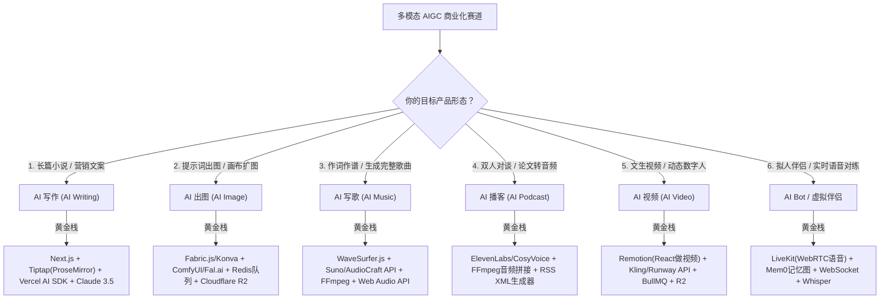

# 全栈、AI 智能体与多模态 AIGC 架构选型全景报表

> [!NOTE]
> 本报表已全面囊括 **AI 写作、AI 出图、AI 写歌、AI 播客、AI 视频生成、实时 AI 虚拟伴侣** 六大多模态垂直领域，并与本仓库中的技术选型矩阵 [`references/tech-stack-matrix.md`](../references/tech-stack-matrix.md) 互通互补。

---

## 1. 多模态 AIGC 垂直领域核心技术栈全景图

---

## 2. 六大多模态垂直赛道工业级实战方案

### 专题 1：AI 写作与长文本创作平台 (AI Writing & Novels)
* **代表产品**：Jasper、Notion AI、Copy.ai、Lex.page、Sudowrite
* **核心业务痛点**：
  1. **长篇上下文丢失与设定混乱**：小说 10 万字以上，大模型容易吃不下或人物性格前后矛盾；
  2. **富文本编辑器光标冲突**：AI 流式输入时，用户同时在打字修改，光标乱跳与协同冲突；
  3. **大纲-细纲-正文的层级规划**。

| 模块 | 推荐工业级技术栈 | 核心选型考量 |
| :--- | :--- | :--- |
| **前端富文本编辑器** | **Tiptap (基于 ProseMirror) 或 Lexical (Meta)** | **严禁手写 contenteditable**。Tiptap 是 Notion/Lex 的行业底座，原生支持行内 AI 自动补全（Inline Ghost Text）、Markdown 快捷语法、选中浮动菜单 |
| **打字机光标同步** | **`diff-match-patch` + Vercel AI SDK** | 流式将 Token 转换为不可变补丁（Delta）追加进编辑器 AST，避免光标被重置 |
| **长文本上下文记忆** | **分层大纲状态机 (Hierarchical RAG)** | 拆分为：世界观设定库、人物卡表、主线伏笔图。写第 15 章时只注入：上一章摘要 + 本章细纲 + 出场人物小卡片 |
| **底座大模型** | **Claude 3.5 Sonnet / DeepSeek-V3** | 文笔自然度与长上下文理解目前公认第一梯队 |

---

### 专题 2：AI 出图与画布生图修图 (AI Image & Generative Canvas)
* **代表产品**：Midjourney、Leonardo.ai、Ideogram、PhotoRoom、Magnific AI
* **核心业务痛点**：
  1. 生成单图需要 5~20 秒，**HTTP 请求绝不能长连接死等**，必须做异步任务轮询/WebSocket 通知；
  2. **局部重绘（Inpainting）与扩图（Outpainting）** 需要前端涂抹蒙版（Mask）；
  3. 图片流量下行带宽极大，AWS S3 出网带宽费用会瞬间吃光利润。

| 模块 | 推荐工业级技术栈 | 核心选型考量 |
| :--- | :--- | :--- |
| **交互式前端画布** | **Fabric.js 或 Konva.js (React-Konva)** | 支持涂抹画笔（生成黑白 Mask 蒙版）、图层分层拖拽、缩放、选区吸附 |
| **生图算力与接口** | **Fal.ai / Replicate / 自建 ComfyUI API** | Fal.ai / Replicate 提供现成 Flux.1 与 SDXL 的极速 API（按秒计费，冷启极快）；自建用 ComfyUI 挂在 RunPod GPU |
| **异步任务流水线** | **Redis + BullMQ (Node) 或 Celery (Python)** | 前端提交后立即返回 `taskId`，后端入队处理，前端通过 WebSocket 监听进度条（20%...60%...完成） |
| **图片存储与 CDN** | **Cloudflare R2 + WebP 自动压缩** | **Cloudflare R2 零出网带宽费（Zero Egress Fee）**，相比 AWS S3 节省 80% 账单；图片在上传前强制转为 WebP/AVIF |

---

### 专题 3：AI 写歌与音乐生成 (AI Music Generation)
* **代表产品**：Suno、Udio、Loudly、Boomy
* **核心业务痛点**：
  1. 音频生成属于重度计算，生成一首完整歌曲耗时 30~60 秒；
  2. 歌词与音频节奏的时间戳对齐（LRC 动态歌词滚动）；
  3. 人声与伴奏分轨（Stems Separation）。

| 模块 | 推荐工业级技术栈 | 核心选型考量 |
| :--- | :--- | :--- |
| **前端波形与播放器** | **WaveSurfer.js + Howler.js** | 渲染高颜值动态音频波形图，支持进度拖拽、循环片段试听、A/B 版本比对 |
| **底层写歌模型 API** | **Suno 官方/代理 API 或 Meta AudioCraft** | 输入风格提示词与分段歌词标签 `[Verse]`、`[Chorus]`、`[Drop]` |
| **歌词对齐引擎** | **OpenAI Whisper (Word-level Timestamps)** | 生成音频后，用 Whisper 提取每个单词的毫秒级时间戳，推导标准 LRC 歌词文件 |
| **分轨与混音剪辑** | **Demucs (Python) + FFmpeg WebAssembly** | Demucs 自动分离伴奏与纯人声；前端可用 FFmpeg.wasm 实现零服务端开销的音频裁剪试听 |

---

### 专题 4：AI 播客与多角色对谈 (AI Podcast & Voice Overview)
* **代表产品**：Google NotebookLM (Audio Overview)、ElevenLabs Reader、Podcastle、Wondercraft
* **核心业务痛点**：
  1. **双人对谈脚本生成**：需要两个人（如男主播幽默调侃 + 女女主播理性犀利）互相打趣、有笑声、有呼吸停顿；
  2. **音轨动态无缝拼接**：多个音频切片拼接时不能有突兀的爆音与机械感；
  3. **标准播客分发**：支持一键导出包含 RSS 的播客源以推送到 Apple Podcasts 与 Spotify。

| 模块 | 推荐工业级技术栈 | 核心选型考量 |
| :--- | :--- | :--- |
| **脚本编排 Prompt 链** | **双角色博弈 Prompt (System + Dialog Parser)** | 约束输出为标准格式：`[Host_A: "语气词/观点"]`、`[Host_B: "打趣/反问"]`，并自动注入 `[laughs]`、`[sighs]` 标签 |
| **高拟真 TTS 语音合成** | **ElevenLabs API 或 阿里 CosyVoice / Fish Audio** | ElevenLabs 的 Conversational Voice 模型支持自然的换气声与笑声；CosyVoice 适合中文高质量克隆 |
| **音频拼接混音引擎** | **FFmpeg (后端 Python/Go 脚本)** | 为每句话加入 150ms~300ms 随机呼吸空白，两段音频间施加 50ms 交叉淡入淡出（Crossfade），消除爆音 |
| **RSS 聚合与发布** | **`podcast` npm 库 / Python `podgen`** | 自动生成包含音频时长、封面、章节节点（Chapter Marks）的 XML，适配全网播客客户端 |

---

### 专题 5：AI 视频生成与数字人编排 (AI Video & Motion)
* **代表产品**：Sora、快手可灵 (Kling)、Runway Gen-3、Luma Dream Machine、HeyGen、Pika
* **核心业务痛点**：
  1. 单个视频切片仅 4~10 秒，需要**多镜头串联（Storyboard 分镜剧本）**；
  2. 视频渲染动辄需要几分钟，对长任务容错要求极高；
  3. **唇形同步（Lip-sync）** 与背景字幕合成。

| 模块 | 推荐工业级技术栈 | 核心选型考量 |
| :--- | :--- | :--- |
| **代码级视频组装底座** | **Remotion (基于 React 写视频)** | **革命性工具**：用 React 代码定义时间轴、动画、字幕弹出与画中画，后端用无头 Chrome 批量渲染出 MP4！ |
| **文生/图生视频模型** | **可灵 Kling API / Runway API / Luma API** | 生成高质量 720p/1080p 短视频镜头切片 |
| **唇形同步（数字人）** | **Wav2Lip 或 LivePortrait** | 输入音频与静止肖像图，毫秒级驱动嘴唇与面部表情随声音开合 |
| **分镜流水线任务编排** | **Temporal (Go/TS) 或 Celery (Python)** | 具备超强故障自愈能力的长工作流引擎：分镜1生成 -> 分镜2生成 -> 混剪拼接，中途某一步超时自动重试 |

---

### 专题 6：AI Bot / 角色扮演与实时语音伴侣 (AI Companions & Voice Bots)
* **代表产品**：Character.ai、Talkie、Replika、Glow、Poe
* **核心业务痛点**：
  1. **极低延迟语音对练（< 800ms）**：传统“STT -> LLM -> TTS”串行链路太慢，用户说话后等待时间长；
  2. **超长情感记忆（Persona & Long-term Memory）**：聊了一个月，它必须记得用户宠物的名字和前天聊的心情；
  3. **情感敏感与安全风控（Safety Guardrails）**。

| 模块 | 推荐工业级技术栈 | 核心选型考量 |
| :--- | :--- | :--- |
| **实时全双工语音传输** | **LiveKit (WebRTC) 或 OpenAI Realtime API** | 抛弃慢速 HTTP 请求，采用 **WebRTC / WebSocket 极速双向流**，支持“随时打断（Barge-in）” |
| **长短期情感记忆图** | **Mem0 (mem0.ai) 或 Zep** | 专为 AI 角色设计的记忆引擎：自动从每轮对话提取实体、偏好、情感关系，生成动态记忆知识图谱 |
| **前端拟人表情与动效** | **Pixi.js (2D Live2D) 或 Three.js (3D 虚拟人)** | 支持加载 Live2D 模型，根据 TTS 振幅自动眨眼、张嘴并做出喜怒哀乐动作 |
| **高并发消息推送** | **Go (Goroutines) + Redis Pub/Sub** | 单机承载数万并发长连接，保持心跳与在线状态广播 |

---

## 3. 多模态媒体存储与下行带宽极速降本方案

> [!WARNING]
> 多模态（图像、音频、高清视频）产品最大的破产陷阱是**云厂商的出网流量账单（Egress Cost）**。AWS S3 每 TB 出网费用高达 $90 美元，一旦视频爆火，流量费将瞬间吞噬全部利润。

### 降本终极三板斧：
1. **对象存储选用 Cloudflare R2**：
   - 与 S3 API 100% 兼容；
   - **零出网带宽费（Zero Egress Fee）**：无论全球用户下载几百 TB 视频和音频，流量费为 $0！仅收取极其便宜的存储费（$0.015/GB）。
2. **预签名直传（Presigned URL Direct Upload）**：
   - 严禁让用户将数十 MB 的图片/视频先传给你的 Node/Python 服务器再转存 S3；
   - 前端向后端请求一个临时安全签名 URL，浏览器直接直传 Cloudflare R2，完全不消耗你自己的服务器带宽。
3. **前端/边缘自动转码（WebP / AVIF / AAC）**：
   - 图片统一通过 Sharp 转换为 WebP，体积减少 60%；
   - 音频通过 FFmpeg 压缩为 128kbps AAC/MP3，人声完全无损且加载极快。

---

## 4. 24 维全景评估大表 (The Master Matrix)

| 领域 | 维度序号与名称 | Node.js (Next.js/TS) | Go (Golang) | Python (FastAPI) | Rust (Axum/Tauri) | PHP (Laravel 11) | Java (Spring Boot) |
| :--- | :--- | :---: | :---: | :---: | :---: | :---: | :---: |
| **一、商业变现与市场准入** | **1. MVP 验证周转期 (Time to Market)** | ⭐️⭐️⭐️⭐️⭐️ | ⭐️⭐️⭐️ | ⭐️⭐️⭐️⭐️ | ⭐️⭐️ | ⭐️⭐️⭐️⭐️⭐️ | ⭐️⭐️ |
| | **2. 海外支付原生成熟度 (Stripe/Lemon)** | ⭐️⭐️⭐️⭐️⭐️ | ⭐️⭐️⭐️ | ⭐️⭐️⭐️ | ⭐️⭐️ | ⭐️⭐️⭐️⭐️ | ⭐️⭐️⭐️ |
| | **3. Google SEO 与社交卡片动态直出** | ⭐️⭐️⭐️⭐️⭐️ | ⭐️⭐️ | ⭐️⭐️ | ⭐️⭐️ | ⭐️⭐️⭐️⭐️ | ⭐️⭐️ |
| | **4. 全球边缘分发与 CDN 亲和力** | ⭐️⭐️⭐️⭐️⭐️ | ⭐️⭐️⭐️ | ⭐️⭐️ | ⭐️⭐️⭐️⭐️⭐️ | ⭐️⭐️ | ⭐️⭐️ |
| | **5. 多租户数据隔离与合规 (SOC2/GDPR)** | ⭐️⭐️⭐️⭐️ | ⭐️⭐️⭐️⭐️ | ⭐️⭐️⭐️ | ⭐️⭐️⭐️⭐️⭐️ | ⭐️⭐️⭐️⭐️ | ⭐️⭐️⭐️⭐️⭐️ |
| **二、算力成本与硬件效率** | **6. 空闲/常驻内存经济性 (RAM Footprint)** | ⭐️⭐️⭐️ (50-150MB) | ⭐️⭐️⭐️⭐️⭐️ (10-30MB) | ⭐️⭐️ (100-300MB) | ⭐️⭐️⭐️⭐️⭐️ (5-15MB) | ⭐️⭐️ (FPM较高) | ⭐️ (200MB-1GB) |
| | **7. 长连接并发网络吞吐 (SSE/C10K)** | ⭐️⭐️⭐️ | ⭐️⭐️⭐️⭐️⭐️ | ⭐️⭐️ | ⭐️⭐️⭐️⭐️⭐️ | ⭐️ | ⭐️⭐️⭐️⭐️ |
| | **8. Serverless 冷启动时延** | ⭐️⭐️⭐️⭐️ (100-250ms) | ⭐️⭐️⭐️⭐️⭐️ (30-80ms) | ⭐️⭐️ (500-1500ms) | ⭐️⭐️⭐️⭐️⭐️ (5-20ms) | ⭐️ (较慢) | ⭐️ (极慢/需GraalVM) |
| | **9. GPU 显存利用与 CUDA 硬件亲和力** | ⭐️ | ⭐️⭐️ | ⭐️⭐️⭐️⭐️⭐️ | ⭐️⭐️⭐️⭐️ | ⭐️ | ⭐️⭐️ |
| | **10. 序列化与协议传输吞吐 (Protobuf/JSON)**| ⭐️⭐️⭐️ | ⭐️⭐️⭐️⭐️⭐️ | ⭐️⭐️ | ⭐️⭐️⭐️⭐️⭐️ | ⭐️⭐️ | ⭐️⭐️⭐️⭐️ |
| **三、AI 原生与智能体生态** | **11. 打字机流式 (SSE) 与 Generative UI** | ⭐️⭐️⭐️⭐️⭐️ | ⭐️⭐️⭐️ | ⭐️⭐️⭐️ | ⭐️⭐️⭐️ | ⭐️ | ⭐️⭐️ |
| | **12. Agent 图状态机与复杂规划 (LangGraph)** | ⭐️⭐️⭐️⭐️ | ⭐️⭐️ | ⭐️⭐️⭐️⭐️⭐️ | ⭐️⭐️ | ⭐️ | ⭐️⭐️ |
| | **13. MCP 协议与工具链生态丰富度** | ⭐️⭐️⭐️⭐️⭐️ | ⭐️⭐️⭐️ | ⭐️⭐️⭐️⭐️⭐️ | ⭐️⭐️⭐️ | ⭐️ | ⭐️⭐️ |
| | **14. 代码执行沙箱隔离与微虚拟机支持** | ⭐️⭐️⭐️⭐️ | ⭐️⭐️⭐️⭐️ | ⭐️⭐️⭐️⭐️⭐️ | ⭐️⭐️⭐️⭐️ | ⭐️ | ⭐️⭐️⭐️ |
| | **15. 长短期记忆、RAG 与向量数据拓扑** | ⭐️⭐️⭐️⭐️ | ⭐️⭐️⭐️ | ⭐️⭐️⭐️⭐️⭐️ | ⭐️⭐️⭐️ | ⭐️⭐️ | ⭐️⭐️⭐️ |
| | **16. 模型预训练、权重微调 (LoRA/DPO)** | ⭐️ (无法胜任) | ⭐️ (无法胜任) | ⭐️⭐️⭐️⭐️⭐️ (绝对统治) | ⭐️⭐️ (底层加速) | ⭐️ (无法胜任) | ⭐️ (无法胜任) |
| **四、工程效能与研发体验** | **17. 全栈端到端类型安全 (Type Sharing)** | ⭐️⭐️⭐️⭐️⭐️ | ⭐️⭐️ | ⭐️⭐️ | ⭐️⭐️⭐️ | ⭐️⭐️ | ⭐️⭐️ |
| | **18. 本地代码热重载与调试周转 (Dev Loop)**| ⭐️⭐️⭐️⭐️⭐️ | ⭐️⭐️⭐️⭐️ | ⭐️⭐️⭐️⭐️ | ⭐️⭐️ (编译耗时) | ⭐️⭐️⭐️⭐️⭐️ | ⭐️⭐️ |
| | **19. 多端跨平台代码共享率 (Multi-Device)** | ⭐️⭐️⭐️⭐️⭐️ (80%+) | ⭐️⭐️ | ⭐️⭐️ | ⭐️⭐️⭐️ (Tauri) | ⭐️ | ⭐️⭐️ |
| | **20. 全网技术人才流动性与开源积淀** | ⭐️⭐️⭐️⭐️⭐️ | ⭐️⭐️⭐️⭐️ | ⭐️⭐️⭐️⭐️⭐️ | ⭐️⭐️ | ⭐️⭐️⭐️⭐️ | ⭐️⭐️⭐️⭐️⭐️ |
| | **21. 十万行级工程重构韧性与编译确定性** | ⭐️⭐️⭐️⭐️ | ⭐️⭐️⭐️⭐️⭐️ | ⭐️⭐️ | ⭐️⭐️⭐️⭐️⭐️ | ⭐️⭐️⭐️ | ⭐️⭐️⭐️⭐️⭐️ |
| **五、运维保障与可观测性** | **22. 部署交付纯粹度 (Single Binary/No Dep)**| ⭐️⭐️⭐️ | ⭐️⭐️⭐️⭐️⭐️ | ⭐️⭐️ | ⭐️⭐️⭐️⭐️⭐️ | ⭐️⭐️ | ⭐️⭐️⭐️ |
| | **23. LLMOps 专用度量成熟度 (Langfuse等)**| ⭐️⭐️⭐️⭐️⭐️ | ⭐️⭐️⭐️ | ⭐️⭐️⭐️⭐️⭐️ | ⭐️⭐️ | ⭐️ | ⭐️⭐️ |
| | **24. 网络震荡容错与断流弹性恢复 (Resilience)**| ⭐️⭐️⭐️ | ⭐️⭐️⭐️⭐️⭐️ | ⭐️⭐️⭐️ | ⭐️⭐️⭐️⭐️⭐️ | ⭐️⭐️ | ⭐️⭐️⭐️⭐️ |
