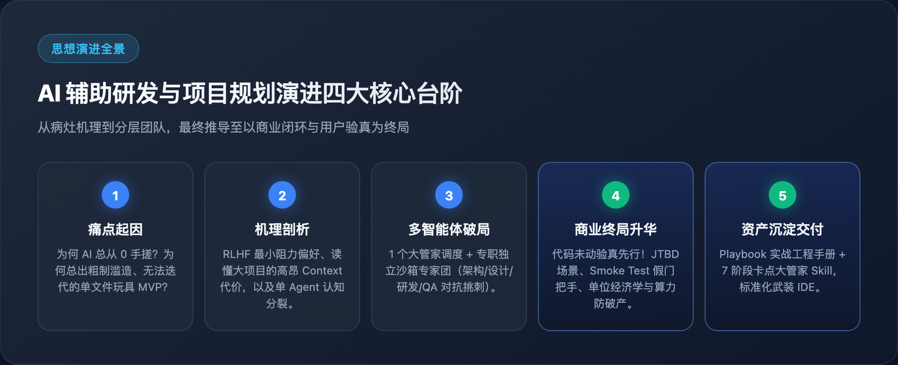
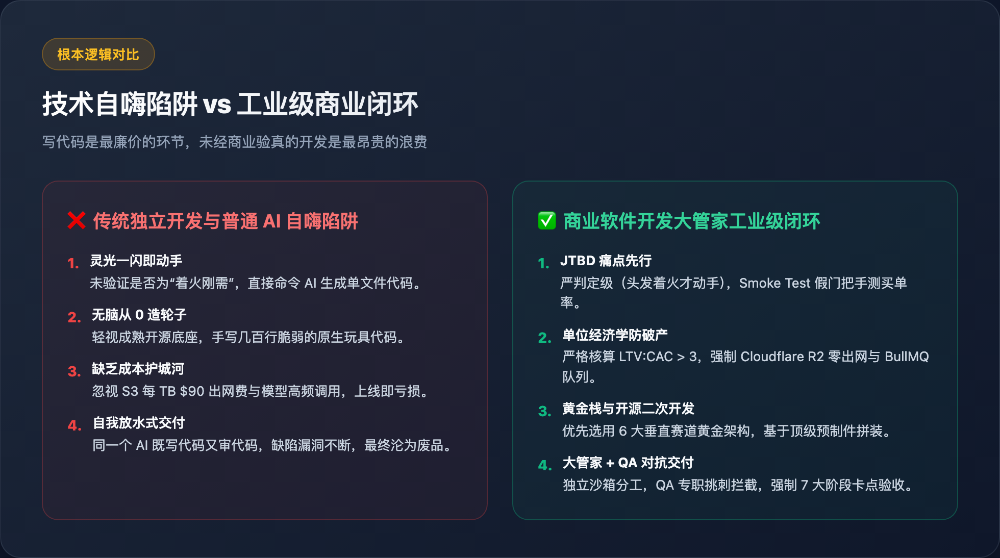
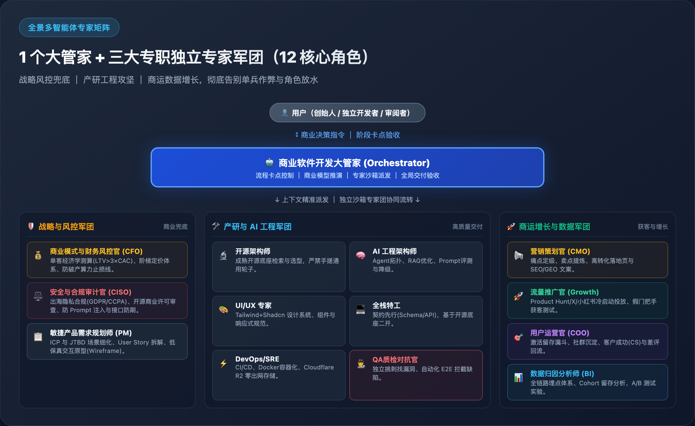
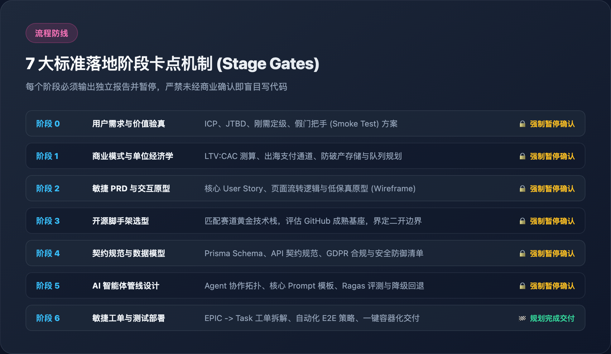
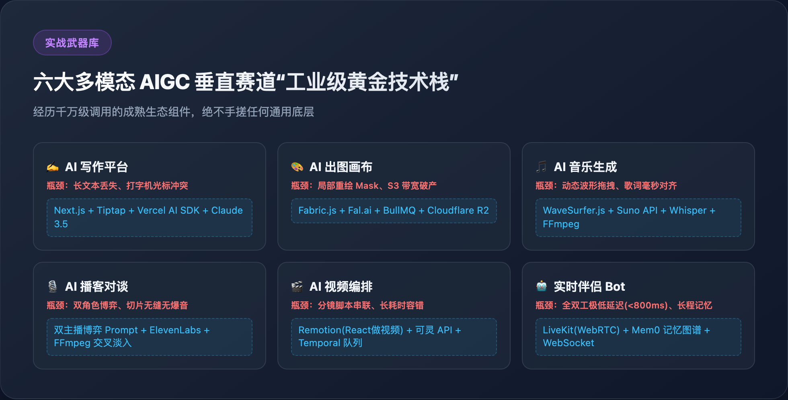

# 微信公众号深度专栏：从技术自恋到商业闭环

> **说明**：本文专为微信公众号排版设计，已配齐 Retina 级高清配图与文章封面。可直接导入 mdnice、微信公众号后台或通过相关排版 Skill 一键渲染发布。

---

## 📌 推荐标题库（按受众与调性自选）

* **痛点暴击型**：《我用 AI 狂写了 10 个项目，终于悟出了为什么 99% 的独立开发注定破产》
* **认知反思型**：《别再让 AI 从 0 给你写 MVP 了：这是我见过最昂贵的“技术自嗨”》
* **技术硬核型**：《为什么 Claude 像资深架构师，而其他 AI 像实习生？背后工程机制全拆解》
* **干货开源型**：《拒绝玩具代码！我们开源了一套商业级“AI 大管家”：把商业闭环堵在写代码之前》

---


### 导语：那个价值 2000 美元的“玩具 MVP”

最近半年来，所有技术社群都在盛传一句话：**“人人都是独立开发者，一个人就是一个独角兽。”**

很多人被这个愿景彻底点燃——输入一句 Prompt，AI 几秒钟吐出几百行代码；打开浏览器，一个花里胡哨的前端页面跑起来了；数据库连上了，API 也调通了。你看着屏幕，仿佛看到了未来的 MRR（月度经常性收入）在向你招手。

**然而，现实很快就会给你一记响亮的耳光：**

1. 当你想要加一个稍微复杂的二级联动或权限系统时，AI 开始胡言乱语，拆东墙补西墙；
2. 当你终于把它推上线，满心欢喜等用户注册，却发现日活是个位数，连身边的亲朋好友都不肯用第二次；
3. 更惨的是，某天早上醒来，发现某个调用了大模型音视频生成的冷门接口被爬虫刷爆了，云厂商账单直接扣了上千美元。

> **“按部就班的研发流程只是执行手段。如果不把【用户需求先行】和【商业闭环】放在最前头，用最顶级的架构写出来的也只是无人买单的自嗨废品。”**

今天这篇文章，我们将彻底剥开当前“AI 辅助研发”中最隐蔽的毒瘤，并分享我们是如何通过一套开源的**“商业软件大管家架构”**，把 AI 从“只会单文件糊玩具的实习生”，改造成“兼具 CEO 商业眼光与资深架构师底线”的工业级交付团队。

---

## 一、病灶剖析：为什么 AI 天生喜欢“从零手搓”与“抢跑 MVP”？

很多人误以为是自己的“提示词（Prompt）”写得不够好。**其实不是。这是大语言模型底层训练偏好（RLHF）与传统软件工程之间的结构性矛盾。**



### 1. 训练偏好的“即时交差心态”
模型被调优为“有求必应、讨好人类”。当你抛出一个模糊的需求（比如“我想做一个出海营销工具”），在模型的潜意识里，**反问你的商业模式或劝你三思，会被认为“偷懒没干活”**。为了最快得到人类的正向反馈，它会本能地选择一条**“阻力最小路径”**：在一个文件里用原生 HTML/JS 糊一个能点按钮的 Demo 出来。

### 2. 读懂大项目的高昂 Context 代价
在 GitHub 上找一个活跃度极高、功能完善的开源二开基座（比如 Medusa、Refine、Chatwoot），需要读懂成千上万行代码的目录结构与接口。  
对 AI 来说：**二开一个成熟项目的 Context 消耗极大；而自己从零乱写 200 行原生代码的消耗极低。** 缺乏硬性工程约束时，AI 必然倾向于“从 0 造轮子”。

### 3. 上下文污染与角色认知分裂
让同一个 Agent 既负责赶工期写业务逻辑，又负责找 Bug、写用例拦截缺陷，结果必然是**自我放水、自欺欺人**。同一个模型自己验证自己，永远是一团和气。

---

## 二、现象解码：为什么 Claude 看起来总像个“资深架构师”？

不少用过 Claude（特别是 3.5 / 3.7 Sonnet）的开发者都有个共同感受：**它写起代码来明显比其他模型更“成熟”、更稳重。**

这不是玄学，而是它内化了顶尖软件工程的三个“思维预制件”：

1. **顾问型性格（Consultative Persona）**：面对大需求，它习惯先停下来梳理架构权衡（Trade-offs），列出可选方案和目录树，绝不盲目吐代码；
2. **社区黄金生态预制件**：写前端默认基于 `Tailwind + shadcn/ui`，写全栈默认基于 `Next.js + Prisma + Zod`。它把社区最好的现代积木当成了默认砖块，绝不重复造轮子；
3. **契约先行（Contract-First）**：先定义 TypeScript `interface` 与数据库 Schema，再填充业务。

**这给了我们极其关键的启示：**  
只要在流程上剥夺 AI 盲目写代码的特权，在架构前强制设置**阶段卡点（Stage Gates）**，我们完全可以将普通 AI 的工程能力推到资深架构师的水准。

---

## 三、终局跃迁：在写第一行代码前，守住两条生死线

解决了技术架构问题，就万事大吉了吗？**并没有。**

软件工程界最痛的领悟莫过于：**你用世界上最优雅的代码、最顶级的 Serverless 架构，做出了一款根本没有人愿意买单的废品。**



在我们的方法论里，代码未动，必须先过两重生死大考：

### 1. 痛点定级：是“头发着火”还是“维他命补充”？
* **着火级刚需（Hair-on-fire）**：用户的头发着火了，你哪怕递给他一块砖头，他也会拿来拍灭火。界面丑一点、偶尔报错，用户依然会哭着求你收钱；
* **维他命级需求（Nice-to-have）**：听起来很酷、很未来，但用户买不买全看心情。AI 独立开发做这种项目，研发周期拖得越长，死得越惨。
* **解法：烟雾测试（Smoke Test / 假门把手）**：做一个落地页直接放 Stripe 支付按钮，算转化率。买单意愿没有验证前，一行核心代码都不要写！

### 2. 算力与流量的“防破产红线”
很多出海开发者赚到了流水，月底一看云厂商账单，利润全赔进去了：
* **AWS S3 出网陷阱**：S3 每 TB 出网费用高达 90 美元！AI 生成的图片、音频如果走普通应用带宽，账单会瞬间击穿商业模型。  
  👉 **生死线**：必须强制使用 **Cloudflare R2（零出网费）**，搭配前端直传。
* **长耗时长连接堵塞**：视频或音频生成动辄 30~60 秒，若采用 HTTP 同步调用，网关会瞬间被占满崩溃。  
  👉 **生死线**：必须强制引入 **Redis + BullMQ 异步队列**，前端通过 SSE/WebSocket 轮询状态。

---

## 四、多智能体破局：告别单兵作弊！三大独立专家军团（12 核心角色）全景就位

很多独立开发者与技术团队最大的误区，就是以为把“架构师、前端、后端、测试”凑齐就万事大吉了。以为只要把代码推上服务器，用户就会蜂拥而至。

**现实是极其残酷的：很多技术人哪怕做出了产品，也会在各种匪夷所思的暗礁前暴毙：**
- **缺合规专家**：不懂 GDPR 或开源许可证商业冲突，刚出海就被欧洲监管调查或 Stripe 封停结算；
- **缺 AI 工程架构师**：以为写两句 Prompt 调 API 就是 AI 产品，结果上线被用户恶意注入提权，Token 账单直接爆表；
- **缺 DevOps 运维**：产品侥幸在 Product Hunt 火了一把，瞬时并发暴涨，单体服务器直接宕机，错失千载难逢的流量窗口；
- **缺营销与推广**：官网全在堆砌“基于 Next.js / Rust 构建”的程序员黑话，根本没人看得懂解决了什么痛点；
- **缺数据归因分析**：不知道哪个渠道带来的用户在付费，钱花光了还在盲目试错。

因此，我们的商业软件大管家彻底重构了多智能体组织阵型，打造了**三大专职独立专家军团（共 12 大核心角色）**，每个角色拥有独立沙箱上下文，各司其职，坚决杜绝“既当运动员又当裁判”的角色放水：



### 1. 🛡️ 商业战略与风控军团 (Strategy & Monetization Pod)
* **💰 商业模式与财务风控官 (CFO)**：负责单客经济学测算（严格咬死 $LTV > 3 \times CAC$）、设计按量与订阅阶梯定价、设立算力止损线，严防破产；
* **⚖️ 安全与合规审计官 (CISO / Legal)**：出海合规护城河！排查 GDPR/CCPA 隐私风险、开源商用许可证（MIT vs GPL）冲突、配置防 Prompt 注入与高频接口防刷；
* **📋 敏捷产品需求规划师 (PM)**：将模糊商业想法转化为可执行的工程需求，细化 ICP 客户画像、JTBD 核心场景与低保真页面原型 (Wireframe)。

### 2. 🛠️ 产研与 AI 工程军团 (Engineering & AI Pod)
* **🔬 开源调研与系统架构师 (Architect)**：检索 GitHub 成熟开源底座（严禁从 0 造轮子），输出清晰的二开边界与 ADR 架构决策；
* **🧠 AI 工程与 Prompt 架构师 (AI Engineer)**：专职搭建 Agent 拓扑、向量检索 (RAG) 调优，并通过 Ragas 自动化评测建立防幻觉与 Token 降级机制；
* **🎨 UI/UX 规范专家 (Designer)**：拒绝山寨廉价感！基于 Tailwind + Shadcn 输出完整设计 Token、组件体系与多端响应式交互规约；
* **💻 全栈开发特工 (Full-Stack Engineer)**：契约先行（Prisma Schema / API 契约），在开源基座上高保真实现定制业务，拒绝过度工程；
* **⚡ DevOps 与云运维专家 (DevOps / SRE)**：搭建 CI/CD 自动化流水线、Docker 容器化镜像，配置 Cloudflare R2 零出网存储与全球 CDN 防宕机；
* **🕵️ QA 质检对抗官 (QA Specialist)**：专职“挑刺找茬”！独立运行自动化 E2E 测试用例，执行对抗性缺陷拦截，代码未达标绝不放行上线。

### 3. 🚀 商运增长与数据军团 (Growth & Operations Pod)
* **📢 营销策划官 (Marketing / CMO)**：解决“认知与购买理由”。把冰冷的技术参数翻译为直击用户痛点的文案（如“3秒智能切片，每天为你省下2小时”），打造高转化率 Landing Page 与 SEO/GEO 护城河；
* **🚀 流量推广官 (Promotion / Growth)**：解决“获客与流量”。在写第一行代码前就制定 Product Hunt、Twitter/X、Reddit、小红书的冷启动打法，用烟雾测试（Smoke Test）实测真实点击付费率；上线后集中引爆公域流量；
* **🎯 用户运营官 (Operations / COO)**：解决“留存与 LTV”。搭建私域社群与客户成功（CS）通路，监控激活留存漏斗，将用户的真实吐槽与差评闭环反馈给大管家，驱动下一轮敏捷迭代；
* **📊 数据分析与归因专家 (Data Analyst / BI)**：拒绝拍脑袋！设计全链路埋点体系、追踪 Cohort 留存曲线，通过严谨的 A/B 测试科学验证商业假设。

> **“大管家就像一位经验老到的 CEO。它不写具体代码，而是精准派发任务、严控 7 大阶段卡点，让三大专家军团协同运转。任何一个角色缺位，商业大厦都会倾斜。”**

---

## 五、开源亮相：商业软件开发大管家 (Project Development Planner)

为了让这套方法论不再只是一篇复盘感悟，而是能被所有开发者在 IDE 里面一键唤醒、即插即用的实战武器，我们正式开源了：

📦 **商业软件开发大管家 (Project Development Planner)**  
🔗 **GitHub 仓库**：[https://github.com/cunzailv/shangyeruanjiankaifa.git](https://github.com/cunzailv/shangyeruanjiankaifa.git)



### 它带来了四大核心革新：

1. **选择题驱动（Choice-Driven）**：人类不擅长填空题，但擅长做选择。大管家拒绝抛出“你想要什么功能”这种空洞问题，而是直接提供打包好的 **Plan A（激进高扩展）** 与 **Plan B（保守快上线）** 供你决策；
2. **严格的 7 大卡点流水线（Stage Gates）**：从阶段 0 到阶段 6，每个阶段输出标准化独立报告后**必须暂停**，未经你的确认，AI 严禁抢跑写代码！
3. **多智能体沙箱路由（Multi-Agent Routing）**：作为总控调度者，在 UI、技术架构、代码审计等专业环节，智能引导你调用独立的子 Agent 专家。
4. **六大多模态赛道黄金技术栈全景集成**：



---

## 六、如何把这套大管家接入你的开发环境？

该项目原生采用标准 Markdown 资产与 Skill 规范，开箱即用，支持多种主流 AI 开发环境：

### 1. Trae / Antigravity（原生支持）
在项目工作区根目录下，将仓库直接克隆到 `.trae/skills/` 或 `.agents/skills/`：
```bash
mkdir -p .trae/skills
cd .trae/skills
git clone https://github.com/cunzailv/shangyeruanjiankaifa.git project-development-planner
```
重启或刷新 IDE，在对话框中输入：  
`/project-development-planner 我想做一个XXX` 即可唤醒大管家！

### 2. Cursor / Windsurf
克隆到项目后，在 `.cursorrules` 中追加：
> `进行项目规划时，请严格遵循 docs/planner/SKILL.md 中的 7 大阶段规范与卡点。规划过程中，请随时读取 assets、docs 和 references 目录下的模板与知识库。`

### 3. Claude Projects
将仓库中的 `SKILL.md`、`docs/`、`references/` 上传至 Project 的 Knowledge，并在自定义指令中指定其扮演该大管家角色。

---

## 结语：让 AI 回归商业与工程的常识

在 AI 编码工具日新月异的今天，写代码的门槛已经被降到了尘埃里。  
**但越是在代码廉价的时代，架构审慎与商业闭环的价值就越发千金难买。**

如果你也曾被 AI 写出的“四不像玩具”折磨过，如果你也希望做出一款真正有人买单、经得起流量考验的商业产品，欢迎把这套大管家配置进你的 IDE 中。

**欢迎到 GitHub 探索与 Star 支持：**  
👉 **[github.com/cunzailv/shangyeruanjiankaifa](https://github.com/cunzailv/shangyeruanjiankaifa)**

---

*你平时在用 AI 写代码时遇到过哪些离谱的“自嗨”坑？欢迎在评论区分享你的血泪史！*
